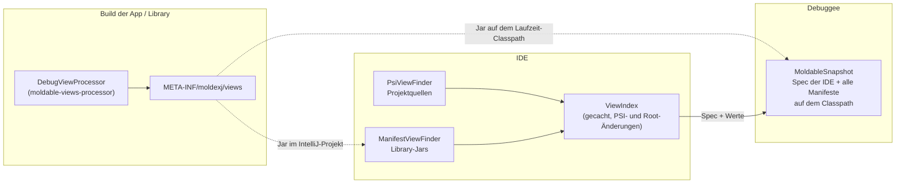
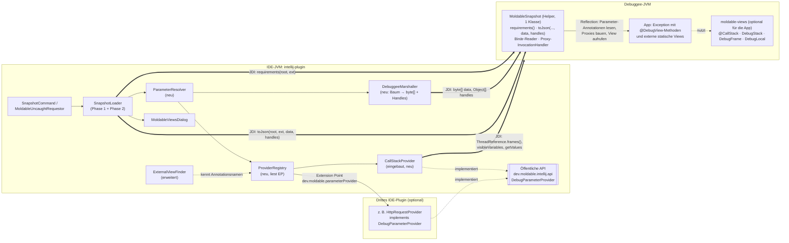
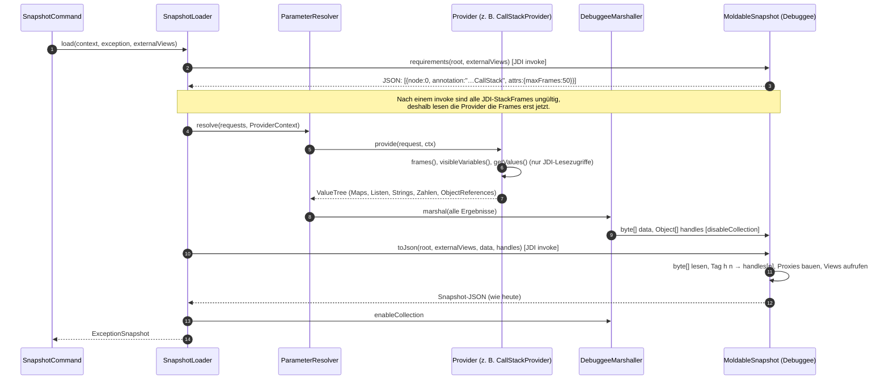
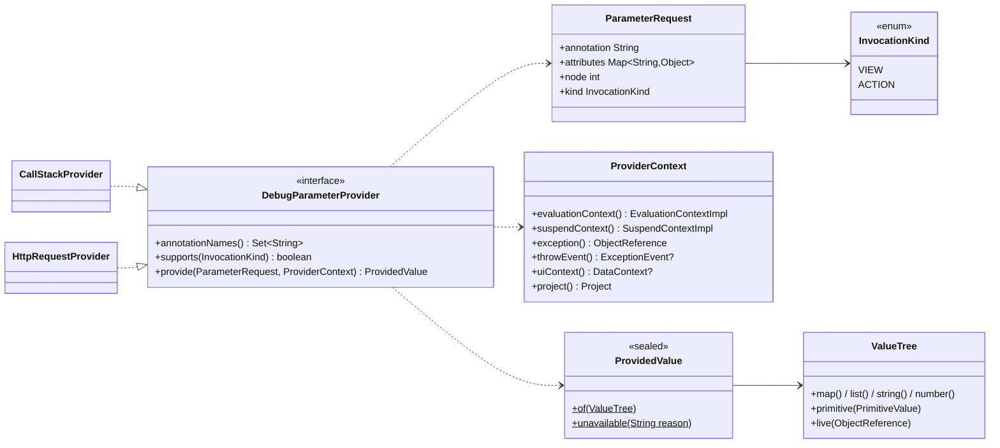

# Entwurf: Debugger-Parameter für Views (`@CallStack` und erweiterbare Provider)

Status: umgesetzt am 2026-10-25, mit den Änderungen aus Abschnitt 0. Die Abschnitte 1 bis 9 sind der ursprüngliche
Entwurf (noch mit den alten Namen `@CallStack` und `dev.moldable.*`); wo Abschnitt 0 abweicht, gilt Abschnitt 0.

**Abgelöst am 2026-10-27** für View-Discovery und Ablauf durch [design-plan-mold.md](design-plan-mold.md): Die IDE
sucht keine Views mehr (kein PSI, kein Manifest-Index), der Debuggee meldet in `plan` die benötigten Daten, und die
Daten-API heißt jetzt `DebuggerDataProvider`. Die Phase 1 aus Abschnitt 3 ist damit als `plan` zurück.

## 0. Stand der Umsetzung

### 0.1 Entscheidungen

| Frage | Entscheidung |
|---|---|
| Annotation für den Stack | `@StackFrames(depth = n)` statt `@CallStack` |
| Wie bekommt eine statische View die Exception? | explizit mit `@Exception`, kein impliziter erster Parameter |
| Typ des Stack-Parameters | Interface (`DebugStack`, `DebugFrame`, `DebugLocal`), bedient über `java.lang.reflect.Proxy`; `Map`/`Object` bekommen die Rohdaten |
| Wo werden Deklarationen gelesen? | PSI für Projektquellen, View-Manifest für kompilierten Code (Libraries) |
| Phase 1 (`requirements()` im Debuggee) | entfällt: die IDE kennt die Parameter aus PSI und Manifest |
| Discovery per Class-Load-Event | verworfen: View-Klassen werden nie geladen, und JDI sieht keine Annotationen |
| Format der Werte IDE → Debuggee | binär (`byte[]` mit Tags + `Object[]` Handles) statt `injectedJson`, siehe 3.3. Debuggee → IDE bleibt JSON |

### 0.2 View-Discovery



- **Manifest** (`ViewManifest`, zeilenbasiert, siehe Javadoc): pro View Klasse, Methode, static/instance und pro
  Parameter Typ und Annotationen mit Attributen. Der Processor ist `aggregating` für Gradle und unterstützt nur
  `ch.moldexj.view.DebugView` (Option `-Amoldexj.debugView=…` für eigene Annotationen). Mit `"*"` würde Gradle wegen
  `@Override` (SOURCE-Retention) immer voll neu kompilieren. Bei Builds, die nur geänderte Dateien übergeben
  (IntelliJ selbst), mergt der Processor mit dem bestehenden Manifest.
- **IDE**: `MoldableExceptionsViewIndex` (Project-Service) kombiniert PSI (`projectScope`) und Manifeste (`FilenameIndex` über alle
  Libraries); Quellen gewinnen bei gleicher Methode. Gecacht bis zur nächsten PSI- oder Root-Änderung.
- **Debuggee**: Der Helper liest zusätzlich alle Manifeste über `ClassLoader.getResources`. Views, die nur dort
  stehen und Debugger-Daten brauchen, zeigen den Grund statt zu laufen (Phase 1 bleibt für diesen Fall offen).

### 0.3 Ablauf bei einem Stopp

1. `SnapshotCommand` bzw. `UncaughtMoldableExceptionRequestor` holen die Views aus `MoldableExceptionsViewIndex` und den werfenden
   Thread aus dem `ExceptionEvent`.
2. `SnapshotLoader.load` bestimmt pro View die Bindung jedes Parameters (`ParameterSource`):
   `ThrownException` → `bind i node`, `Unsupported` → `bind i missing <Grund>`, `Provided` → `bind i value k`.
   Debugger-Daten werden nur für Views aufgelöst, die zur Root-Exception passen (`DebuggerUtils.instanceOf`, ohne
   invoke), und pro gleichen `DataRequestArguments` nur einmal.
3. Erst danach wird der Helper geladen (`defineClass` ist ein invoke und macht Frames ungültig).
4. `DebuggeeMarshaller` schreibt die Werte mit `DataOutputStream` in ein `byte[]` (Tags siehe `InjectedValues`:
   Großbuchstaben sind Primitive nach JVM-Deskriptor, `h n` ist `handles[n]`) und sammelt die Live-Objekte in einem
   `Object[]`.
5. `toJson(root, spec, injected, handles)` im Helper bindet die Parameter (`bind i exception|value k|missing`), baut
   Proxies und ruft die Views auf. Fehlt ein Wert, entsteht ein Tab der Art `unavailable` mit dem Grund.

Die Runtime ist nicht mehr auf eine Klasse beschränkt: `HelperLoader` definiert alle Klassen aus
`META-INF/moldexj/runtime-classes` in den Loader im Debuggee, Oberklassen und Interfaces zuerst (`RuntimeClasses`,
per ASM). Es bleiben Java-8-Bytecode und nur JDK-Abhängigkeiten.

### 0.4 Erweiterung um eine neue Annotation

1. `DataRequestDeclarationProcessor`: `accept(AnnotationData)` und `createSource(...)`, das
   `ParameterSource.Provided(args, processor)` liefert. `AnnotationData` ist neutral, also für PSI und Manifest gleich.
2. `DataRequestProcessor<A>`: liefert `ProvidedValue.of(baum)` aus Maps, Listen, Strings, Zahlen und JDI-Werten,
   oder `ProvidedValue.unavailable(grund)`. Berechnete Proxy-Methoden über `"$lookup:<methode>"` und `"$text:<methode>"`.
3. In `DataRequestRegistry` registrieren. Ein Extension Point (Abschnitt 5) ist noch nicht umgesetzt.

### 0.5 Was getestet ist

- Processor: Manifest der Demo, inkrementeller Gradle-Build (Manifest bleibt vollständig, keine volle Neukompilierung).
- Helper in einer normalen JVM: Bindung, Proxies (`frameOf`, `local`, `text`), Primitive, Cause ohne Stack,
  `unavailable`, Discovery nur über Manifeste, altes Spec-Format.
- JDI Ende-zu-Ende ohne IntelliJ: Stopp am uncaught Throw der Demo, Frames gelesen, über `DebuggeeMarshaller` und
  `Object[]` an den Helper übergeben, View mit Live-`User` aus `main` ausgeführt.
- Plugin kompiliert und paketiert. **Nicht** getestet: der Lauf im echten IDE (`runIde`), also
  `StackFramesDataRequestProcessor` mit IntelliJs Proxies, `PsiViewFinder` und `ManifestViewFinder`.

## 1. Ziel

Views laufen heute im Debuggee und sehen nur, was die Exception selbst weiß. Das ist im Wesentlichen
`getStackTrace()`, also Klasse, Methode, Datei und Zeile. Der Debugger weiß mehr: Für jeden Frame des
werfenden Threads kennt er `this`, die Argumente und die lokalen Variablen.

Eine View-Methode soll diese Informationen **anfordern** können, indem sie einen Parameter annotiert:

```java
@DebugView("Cart at checkout")
private DebugViews.View cartView(@CallStack DebugStack stack) {
    DebugFrame frame = stack.frameOf("demo.Checkout", "submit");
    Cart cart = (Cart) frame.local("cart").value();          // Live-Objekt aus dem Frame
    return DebugViews.table(cart.items(), ...);
}

@DebugView("Locals")
static String locals(IllegalStateException e, @CallStack(maxFrames = 5) DebugStack stack) {
    StringBuilder sb = new StringBuilder();
    for (DebugFrame f : stack.frames())
        for (DebugLocal l : f.locals())
            sb.append(f.methodName()).append(": ").append(l.name()).append(" = ").append(l.text()).append('\n');
    return sb.toString();                                      // nur Text, kein Live-Zugriff
}
```

Ohne annotierten Parameter ändert sich nichts. Der Debugger berechnet den Stack nur, wenn mindestens eine
View in der Kette ihn anfordert.

Der Mechanismus ist **nicht** auf `@CallStack` beschränkt. Andere IDE-Plugins können über einen
IntelliJ-Extension-Point weitere Parameter-Annotationen samt Provider registrieren. Derselbe Mechanismus
soll später auch für **Actions** gelten (Methoden, die der Benutzer per Klick im Debuggee auslöst). Auch
diese sollen zusätzliche Debugger-Informationen anfordern können.

## 2. Architektur im Überblick



Die Zweiteilung IDE/Debuggee bleibt wie gehabt. Neu sind:

| Baustein | Seite | Aufgabe |
|---|---|---|
| `@CallStack`, `DebugStack`, `DebugFrame`, `DebugLocal` | moldable-views (Java 8) | Annotation und lesbare Interfaces für die View |
| `requirements(...)` | Helper | Phase 1: meldet, welche annotierten Parameter die Views der Kette haben |
| `toJson(..., data, handles)` | Helper | Phase 2: wie heute, aber mit injizierten Werten für die Parameter |
| `DebugParameterProvider` + Extension Point | intellij-plugin, öffentliche API | Erweiterungsschnittstelle: Annotation → Wert |
| `ProviderRegistry` | intellij-plugin | sammelt eingebaute und fremde Provider, löst Annotationsnamen auf |
| `ParameterResolver` | intellij-plugin | ordnet Anforderungen aus Phase 1 den Providern zu und ruft sie auf |
| `DebuggeeMarshaller` | intellij-plugin | bringt die Provider-Ergebnisse mit möglichst wenigen JDI-Aufrufen in den Debuggee |
| `CallStackProvider` | intellij-plugin | erster Provider, registriert über denselben Extension Point wie fremde |

## 3. Ablauf

Der Ablauf hat zwei Phasen, weil der Debugger erst wissen muss, *was* angefordert wird, bevor er es teuer
berechnet. Wenn keine View etwas anfordert, entfällt Phase 1b, und der Ablauf ist praktisch der heutige.



### 3.1 Phase 1: `requirements`

Neue Methode im Helper:

```java
public static String requirements(Throwable root, String externalViews)
```

Sie läuft die Kette genau wie `walk` ab, sammelt aber nur die View-Methoden ein und ruft sie **nicht** auf. Für
jeden Parameter liest sie die Annotationen und meldet eine Anforderung:

```json
{"requests":[
  {"node":0, "annotation":"dev.moldable.exceptions.CallStack", "simpleName":"CallStack",
   "attributes":{"maxFrames":50, "locals":true, "required":true}}
], "hasViews":true}
```

- `node` ist der Index in der Walk-Reihenfolge. Die Reihenfolge ist deterministisch, weil das Programm
  zwischen Phase 1 und 2 angehalten bleibt.
- Die Attribute werden wie heute bei `@DebugView` per Reflection ausgelesen (Annotation-Methoden ohne
  Parameter) und als Konfiguration an den Provider durchgereicht.
- Gleiche Anforderungen (gleiche Annotation und gleiche Attribute am selben Node) werden zusammengefasst.
- `hasViews` liefert nebenbei die günstige Entscheidung, die `MoldableUncaughtRequestor` braucht, um zu stoppen.
  Der Requestor muss dafür keinen vollen Snapshot mehr berechnen, und vor allem keinen Stack.

### 3.2 Provider auflösen

`ParameterResolver` sucht für jede Anforderung einen Provider in der `ProviderRegistry`:

1. Zuerst über den vollqualifizierten Annotationsnamen.
2. Für die eingebauten Annotationen aus moldable-views zusätzlich über den einfachen Namen (`CallStack`), so wie
   heute bei `DebugView`. Eine App kann sich die Annotation also selbst deklarieren.
3. Gibt es keinen Provider, ist die Anforderung unerfüllbar (siehe 3.4).

Jeder Aufruf `provide` wird abgesichert: Exceptions und Timeouts des Providers werden pro Anforderung zu
„nicht verfügbar: <Grund>“ und reißen nie den ganzen Snapshot mit.

### 3.3 Phase 2: Transport in den Debuggee

Ein naiver Transport würde für jede Map, jede Liste und jeden geboxten Primitivwert eigene JDI-Arrays anlegen
oder `Integer.valueOf` aufrufen, also Hunderte Roundtrips. Stattdessen werden **Daten und Live-Objekte getrennt**:

- **`data`**: ein einziges `byte[]` mit allen Werten, geschrieben mit `DataOutputStream`. Jeder Wert beginnt
  mit einem Tag-Byte. Großbuchstaben sind Primitive nach JVM-Deskriptor (`I` int, `J` long, `C` char, …),
  Kleinbuchstaben Struktur (`s` String, `l` Liste, `m` Map, `n` null, `u` nicht verfügbar). Ein Live-Objekt
  ist `h` + Index in `handles`. Die vollständige Tabelle steht im Javadoc von `InjectedValues`.
- **`handles`**: ein einziges `Object[]` im Debuggee mit allen `ObjectReference`s (`this`, Argumente,
  Locals). Es wird über `ArrayType.newInstance` und `setValues` erzeugt.

Das sind zwei Allokationen plus ein `invoke`, unabhängig von der Datenmenge. Beide werden mit
`disableCollection()` vor dem GC geschützt und nach dem Aufruf wieder freigegeben, wie heute bei `spec`.

Neue Helper-Signatur. Die alten Overloads bleiben und delegieren mit leeren Werten:

```java
public static String toJson(Throwable root, String externalViews, byte[] data, Object[] handles)
```

**Warum binär und nicht JSON wie in der Gegenrichtung?** Der ursprüngliche Entwurf sah hier einen JSON-String
`injectedJson` vor. Umgesetzt ist das Binärformat, weil hier der Debuggee *lesen* muss:

- Der Debuggee hat keine Bibliotheken (Java 8, in eine fremde JVM definiert). JSON zu lesen hieße, dort einen
  Parser mit Escapes, `\uXXXX` und Zahlensyntax zu schreiben. `DataInputStream` ist im JDK, und der Reader hat
  rund 80 Zeilen.
- JSON kennt nur „Zahl“. Ein lokales `long`, `char` oder `byte` muss aber als `Long`, `Character` oder `Byte`
  ankommen. Mit JSON bräuchte jeder Primitivwert einen Wrapper wie `{"$p":"int","v":42}`. `NaN` und `Infinity`
  sind in JSON gar nicht darstellbar.
- Live-Objekte bräuchten einen Platzhalter wie `{"$h":n}`, der mit einer echten Map mit Schlüssel `"$h"`
  kollidiert. Im Binärformat ist das ein eigenes Tag.

Die Gegenrichtung (Anforderungen und Snapshot) bleibt JSON: Der Debuggee *schreibt* dort nur, was trivial ist,
die IDE liest mit Gson, und der Inhalt hat weder Live-Objekte noch exakte Zahlentypen. Die Reihenfolge von
Map-Einträgen ist kein Argument für das eine oder andere Format: Beide Seiten lesen Maps mit Einfügereihenfolge
(`LinkedHashMap` bzw. Gsons `LinkedTreeMap`). Ausführlich: [design-plan-mold.md](design-plan-mold.md), Abschnitt 6.

### 3.4 Aufruf der View im Helper

Die Erkennung von Views wird gelockert:

| View-Art | heute | neu |
|---|---|---|
| Instanzmethode der Exception | 0 Parameter | 0..n Parameter, **alle** annotiert |
| externe statische View | genau 1 Parameter (die Exception) | 1. Parameter die Exception, alle weiteren annotiert |

Methoden mit einem nicht annotierten Zusatzparameter sind weiterhin keine Views.

Pro Parameter bestimmt der Helper den Wert so:

1. Er sucht den injizierten Wert für `(node, annotation, attributes)`.
2. Er passt ihn an den **deklarierten Parametertyp** an:
   - Ist der Typ `Object`, `Map` oder `List`, gibt er die rohe JDK-Struktur weiter.
   - Ist der Typ ein **Interface**, also `DebugStack` aus moldable-views oder ein eigenes Interface der App mit
     derselben Form, baut er einen `java.lang.reflect.Proxy`. `MoldableException` implementiert dafür selbst
     `InvocationHandler`, und jede Instanz hält eine Map. So bleibt der Helper **eine einzige Klasse**,
     denn die Proxy-Klasse erzeugt das JDK. Eine Methode `foo()` liest den Map-Eintrag `foo`.
     Liefert sie `List<X>` mit einem Interface `X`, entstehen Proxies für die Elemente. Fehlende Einträge
     werden zu `null`, `0` oder `false`.
   - Ein anderer konkreter Typ, für den die Anpassung nicht klappt, führt zu einem Fehler-Tab mit Grund.
3. Fehlt der Wert:
   - Bei `required = true` (Default) ruft der Helper die View **nicht** auf. Stattdessen zeigt er ein Tab mit
     dem Grund, z. B. *„Benötigt den Call-Stack zum Zeitpunkt des Throws, der hier nicht verfügbar ist.“*
   - Bei `required = false` übergibt er `null`.

Dass die App moldable-views nicht braucht, bleibt damit gewahrt: Sie kann `@CallStack` und `DebugStack`
selbst deklarieren, und der Helper bedient sie über den Namen und den Proxy.

## 4. Der Call-Stack: Live-Objekte und Text

### 4.1 App-seitige API (moldable-views, Java 8)

```java
@Retention(RUNTIME) @Target(PARAMETER)
public @interface CallStack {
    int maxFrames() default 50;          // hartes Limit im Plugin: 200 (MoldableSnapshot.MAX_FRAMES)
    boolean locals() default true;       // false: nur Methode/Zeile/this, deutlich billiger
    boolean required() default true;     // false: null statt "nicht verfügbar"-Tab
}

public interface DebugStack {
    List<DebugFrame> frames();           // [0] = Throw-Punkt
    DebugFrame frameOf(String className, String methodName);   // erster passender Frame oder null
    boolean truncated();
}

public interface DebugFrame {
    int index();
    String className();  String methodName();  String fileName();  int line();
    Object thisObject();                 // live; null bei statischen Methoden
    List<DebugLocal> locals();           // Argumente zuerst, dann sichtbare Locals
    DebugLocal local(String name);       // oder null
    boolean hasDebugInfo();              // false: ohne -g kompiliert, nur Argumente ohne Namen (arg0..)
}

public interface DebugLocal {
    String name();  String typeName();  boolean isArgument();
    Object value();                      // LIVE: das echte Objekt bzw. geboxter Primitivwert
    String text();                       // TEXT: sicherer, gekürzter toString()-Snapshot
}
```

`frameOf`, `local` und `text` sind keine Map-Zugriffe, sondern berechnete Methoden. Der
`InvocationHandler` im Helper behandelt sie gezielt: `frameOf`/`local` suchen in der Liste,
`text` ruft `safeToString` mit `MAX_TEXT` auf.

### 4.2 Live vs. Text

Beides ist **gleichzeitig** verfügbar, die View entscheidet pro Zugriff:

| | `value()` (live) | `text()` |
|---|---|---|
| Was | das echte Objekt aus dem Frame, z. B. die `Cart`-Instanz | String-Darstellung |
| Woher | `ObjectReference` aus JDI, über `handles` durchgereicht | Primitive und Strings: im Plugin aus JDI (gratis). Objekte: **lazy** im Debuggee über `safeToString`, nur wenn `text()` aufgerufen wird |
| Möglich | Methoden aufrufen, Felder lesen, Tabellen/Diffs bauen | anzeigen, durchsuchen |
| Risiken | Seiteneffekte, `ClassCastException` bei anderem Classloader, nur gültig während das Programm angehalten ist | praktisch keine, `toString` kann aber selbst werfen (wird abgefangen) |

Ausbaustufe (nicht Teil der ersten Version): ein Attribut `@CallStack(ideText = true)`, bei dem das Plugin den
Text mit IntelliJs `NodeRenderer`n erzeugt. Dann sähe die View dieselbe Darstellung wie die Variables-Ansicht.
Das ist aber teurer, weil Renderer selbst Methoden im Debuggee aufrufen.

### 4.3 Wann ist der Stack verfügbar?

Der Call-Stack mit Locals existiert nur, **solange die Frames noch auf dem Thread liegen**:

| Situation | Verfügbar? |
|---|---|
| Uncaught-/Exception-Breakpoint: die gerade geworfene Exception (Node 0 der Kette) | ja, `SuspendContext.getEventSet()` enthält das `ExceptionEvent` für genau dieses Objekt |
| Ursachen (`cause`, `suppressed`) derselben Kette | nein, ihre Frames sind längst abgeräumt |
| „Show Moldable Views“ auf einer Variable an einem normalen Breakpoint | nein, der aktuelle Stack gehört nicht zur Exception |

`CallStackProvider` prüft das über `ProviderContext.throwEvent()` und liefert sonst „nicht verfügbar“ mit
Grund. Später denkbar: ein Attribut `@CallStack(source = CURRENT_THREAD)`, das bewusst den aktuellen Stack
liefert, mit `DebugStack.atThrowSite() == false`.

### 4.4 Ablauf in `CallStackProvider`

1. Thread aus dem `ExceptionEvent` nehmen und `ThreadReferenceProxyImpl.frames()` lesen (bis `maxFrames`).
2. Pro Frame: `location()`, `thisObject()` und, wenn `locals`, `visibleVariables()` + `getValues()`.
   Eine `AbsentInformationException` führt zu `hasDebugInfo = false`, dann mit `getArgumentValues()` weiter.
3. Primitive und Strings direkt als Werte im `byte[]`, Objekte als Handle.
4. Limits: maxFrames, max. 64 Locals pro Frame, max. 2.000 Handles, Daten ≤ 1 MB. Wird ein Limit
   überschritten, setzt der Provider `truncated = true`.

Es gibt dabei nur JDI-Lesezugriffe und keinen `invoke`. Der Provider ist damit schnell und frei von Seiteneffekten.

## 5. Erweiterbarkeit: der Extension Point

### 5.1 Registrierung

In `intellij-plugin/src/main/resources/META-INF/plugin.xml`:

```xml
<extensionPoints>
  <extensionPoint qualifiedName="dev.moldable.parameterProvider"
                  interface="dev.moldable.intellij.api.DebugParameterProvider"
                  dynamic="true"/>
</extensionPoints>

<extensions defaultExtensionNs="dev.moldable">
  <parameterProvider implementation="dev.moldable.intellij.CallStackProvider"/>
</extensions>
```

Ein fremdes Plugin:

```xml
<depends>dev.moldable.exceptions</depends>
<extensions defaultExtensionNs="dev.moldable">
  <parameterProvider implementation="com.acme.HttpRequestProvider"/>
</extensions>
```

`dynamic="true"` erlaubt das Laden und Entladen ohne IDE-Neustart. Die `ProviderRegistry` hört auf
`ExtensionPointListener` und verwirft ihre Caches.

### 5.2 Schnittstelle (Paket `dev.moldable.intellij.api`)



Leitlinien für Provider:

- Ein Provider gibt einen **neutralen `ValueTree`** zurück und berührt keine JDI-Arrays. Die Umsetzung in
  `byte[]` und Handles erledigt der `DebuggeeMarshaller` zentral. So bleiben Limits, GC-Schutz und
  Effizienz an einer Stelle.
- Ein Provider läuft auf dem Debugger-Manager-Thread. JDI-Lesezugriffe sind erlaubt. `invokeMethod` ist
  erlaubt, aber teuer, und es macht die bereits gelesenen StackFrames ungültig. Der `ParameterResolver` ruft
  deshalb Provider, die Frames lesen, **vor** Providern auf, die `invoke` benutzen. Das Interface bekommt dafür
  ein Flag `usesInvoke()`.
- Die App-seitige Annotation liefert der Provider-Autor selbst, z. B. als kleine Java-8-Library, oder die
  App deklariert sie. Gematcht wird über den vollqualifizierten Namen, den `annotationNames()` liefert.
- Bei Namenskonflikten gewinnt der erste Provider in EP-Reihenfolge (`order="first"` ist möglich), und
  das Plugin protokolliert eine Warnung.

### 5.3 Auswirkungen auf `ExternalViewFinder`

Heute akzeptiert der Finder nur statische Methoden mit genau einem Parameter. Neu akzeptiert er zusätzliche
Parameter, wenn sie eine Annotation tragen, deren Name in `ProviderRegistry.knownAnnotationNames()` steht. Die
Registry ist damit die einzige Quelle dafür, welche Annotationen es gibt.

## 6. Actions

Der Mechanismus hängt bewusst nicht an Views. Der Kern ist: „Für eine Methode im Debuggee, deren Parameter
annotiert sind, beschaffe die Werte und rufe sie auf.“ Views sind nur der erste Anwendungsfall.

Für spätere Actions (z. B. `@DebugAction("Retry with fixed payload")`) heißt das:

- Dieselben Parameter-Annotationen funktionieren auch dort, z. B. `@CallStack`.
- `ParameterRequest.kind == ACTION`. Ein Provider kann dann mehr oder anderes liefern, oder per
  `supports(kind)` nur für Actions verfügbar sein. Beispiel: ein `@SelectedFrame`-Provider, der den in der
  IDE ausgewählten Frame liefert. Das ergibt nur bei einem Klick Sinn, daher `ProviderContext.uiContext()`.
- Die Werte werden erst **beim Klick** beschafft, nicht schon beim Snapshot. Das Programm ist dann noch
  angehalten, aber dazwischen können andere Auswertungen gelaufen sein. Der Ablauf ist derselbe:
  Phase 1 nur für diese eine Methode, dann Provider, Marshaller und Aufruf.
- Im Helper bekommt die Methode, die eine einzelne Methode mit Parametern aufruft, eine eigene Form
  (`invokeWithParameters`). `customViews` und eine spätere Action-Ausführung nutzen sie gemeinsam.

## 7. Grenzen und Risiken

- **Gültigkeit von Frames:** Jeder `invoke` im Debuggee macht die JDI-`StackFrame`s des Threads ungültig.
  Deshalb muss die Reihenfolge requirements → Frames lesen → toJson eingehalten werden. `ObjectReference`s
  bleiben gültig. Ohne GC-Schutz sind sie aber nur sicher, solange alles angehalten ist (`SUSPEND_ALL`,
  wie heute).
- **Live-Objekte:** Views können damit Zustand verändern. Das war über die Felder der Exception schon heute
  möglich, die Reichweite ist jetzt aber größer. Die Dokumentation sollte „schnell und ohne Seiteneffekte“
  deutlicher betonen.
- **Classloader:** `(Cart) frame.local("cart").value()` klappt nur, wenn `Cart` im Classloader der View
  derselbe Typ ist. Bei Containern mit mehreren Loadern hilft Duck-Typing über eigene Interfaces oder die
  Nutzung als `Object`.
- **Ohne Debug-Info** (`-g:none`) gibt es keine Namen für Locals, nur Argumente als `arg0..`.
- **Kosten:** Ein Stack mit Locals bedeutet viele JDI-Roundtrips. Die Limits und die Option `locals = false`
  halten das klein, und ohne Anforderung entstehen keine Kosten.
- **Helper-Constraints:** Proxy-Handler, Binär-Reader und Primitiv-Boxing müssen mit Java 8 und nur mit
  JDK-Klassen auskommen. Der Reader ist ein rekursiver Abstieg über einen `DataInputStream`.

## 8. Umsetzungsschritte

1. **moldable-views:** `@CallStack`, `DebugStack`, `DebugFrame` und `DebugLocal` hinzufügen.
2. **Helper:** `requirements()`, den Binär-Reader, `implements InvocationHandler`, das Lockern der View-Erkennung,
   die Parameterbindung und die neue `toJson`-Überladung umsetzen.
3. **Plugin, API:** Paket `dev.moldable.intellij.api` mit `DebugParameterProvider`, `ParameterRequest`,
   `ProviderContext`, `ProvidedValue`, `ValueTree` und `InvocationKind` anlegen. Extension Point in `plugin.xml`.
4. **Plugin, Kern:** `ProviderRegistry`, `ParameterResolver` und `DebuggeeMarshaller` bauen und
   `SnapshotLoader.load` auf zwei Phasen umstellen.
5. **`CallStackProvider`** schreiben und über den Extension Point registrieren.
6. `MoldableUncaughtRequestor` so umbauen, dass er nur `requirements()` bzw. `hasViews` nutzt.
   `ExternalViewFinder` um annotierte Zusatzparameter erweitern.
7. **Dialog:** ein neuer Tab-Zustand „nicht verfügbar“ mit Grund. Optional zeigt das View-Tab einen Hinweis,
   welche Debugger-Daten es verwendet.
8. **Beispiel** in `samples/checkout-demo`: eine View, die per `@CallStack` die `Cart` aus dem Frame von
   `Checkout.submit` als Tabelle zeigt (live), und eine statische View, die alle Locals als Text auflistet.

## 9. Offene Fragen

- Soll `requirements` pro Exception-Klasse gecacht werden (gültig bis HotSwap), um den zusätzlichen `invoke` zu sparen?
- Soll ein Provider die Werte für mehrere Nodes auf einmal liefern können (Batch), z. B. für teure Abfragen?
- Sollen Views auch IDE-seitige Daten bekommen, die gar nicht in den Debuggee müssen (z. B. Git-Blame der
  Throw-Zeile)? Dafür wäre eher eine IDE-seitige View-Art passend als ein Parameter.
