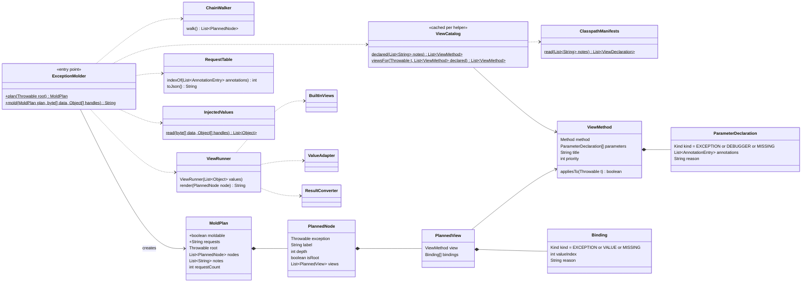
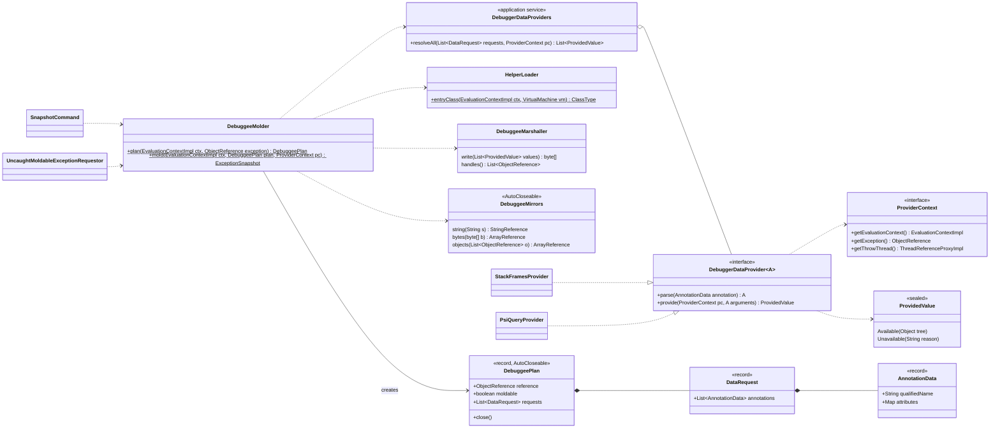
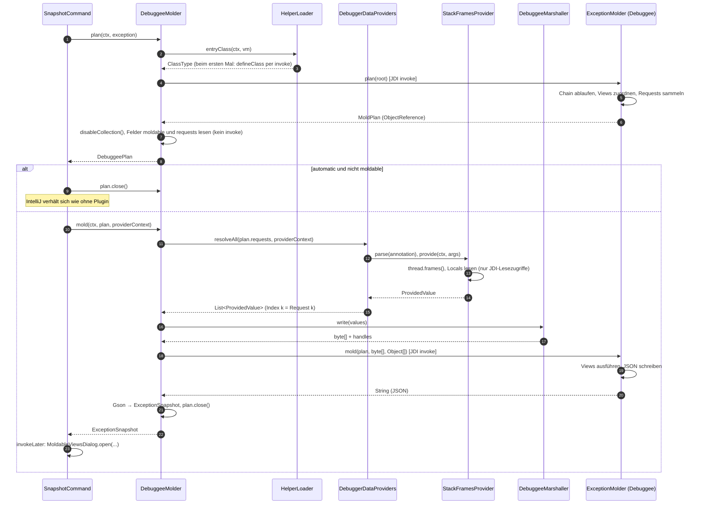
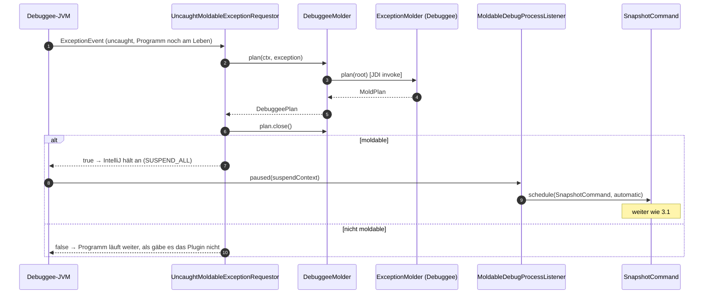

# Entwurf: `plan` / `mold` – der Debuggee kennt die Views

Status: Entwurf vom 2026-10-27, am selben Tag auf dem Branch `v2` umgesetzt. Noch nicht in einer echten Debug-Session
getestet (siehe Abschnitt 8). Löst Abschnitt 0 von `design-debugger-parameters.md` ab, wo es um die View-Discovery und
den Ablauf eines Snapshots geht.

## 1. Entscheidungen

| Frage | Entscheidung |
|---|---|
| Wer findet die Views? | Nur der Debuggee: Manifeste auf dem Classpath, dazu Reflection für parameterlose Instance-Views der Exception |
| Was macht die IDE? | Sie löst nur noch die Debugger-Daten auf, die der Debuggee anfordert (`@StackFrames`, `@PsiQuery`, …) |
| Protokoll | Zwei Aufrufe: `plan(root)` → `MoldPlan`, dann `mold(plan, data, handles)` → JSON |
| Einstieg im Debuggee | `ExceptionMolder` (bisher `MoldableException`) |
| Daten-API im Plugin | ein Interface `DebuggerDataProvider<A>` mit `parse` und `provide`, Registry `DebuggerDataProviders` |
| Views mit Parametern ohne Manifest | gibt es nicht: der `DebugViewProcessor` muss im Build laufen (Parameter-Annotationen sind `CLASS`-retained) |
| Formate | Debuggee → IDE: immer JSON. IDE → Debuggee: immer Binär (`byte[]` + `Object[]`). Siehe Abschnitt 6 |
| Fällt weg | `MoldableExceptionsViewIndex`, `PsiViewFinder`, `ManifestViewFinder`, `ViewFinder`, `View`, `Parameter`, `ParameterSource`, `ViewSpec`, der View-Spec überhaupt |

## 2. Klassen

### 2.1 Debuggee (`moldable-views-rt`, Java 8, keine Abhängigkeiten)



Inhaltlich unverändert bleiben `BuiltInViews`, `ValueAdapter`, `DataProxy`, `ResultConverter`, `Json`, `ViewJson`,
`Reflection`, `Safe`, `Unavailable` und `manifest.ViewManifest`. `Limits` ist aufgelöst: Die Grenzen stehen als
`*_LIMIT`-Konstanten in den Klassen, die sie anwenden (`ChainWalker`, `Safe`, `ResultConverter`, `BuiltInViews`).

Pakete:

```
ch.moldexj.runtime            ExceptionMolder, MoldPlan (Einstieg für DebuggeeMolder, Namen und Signaturen fix)
ch.moldexj.runtime.catalog    ViewCatalog, ViewMethod, ParameterDeclaration; intern: ClasspathManifests, ViewDeclaration
ch.moldexj.runtime.plan       ChainWalker, PlannedNode, PlannedView, Binding, RequestTable
ch.moldexj.runtime.mold       ViewRunner, Json; intern: ResultConverter, BuiltInViews, ViewJson
ch.moldexj.runtime.value      InjectedValues, Unavailable, ValueAdapter; intern: DataProxy
ch.moldexj.runtime.util       Reflection, Safe
ch.moldexj.runtime.manifest   ViewManifest
```

Was paketübergreifend benutzt wird, ist `public final class`; „intern“ heißt package-private. Die Datenklassen
(`PlannedNode`, `PlannedView`, `Binding`, `ParameterDeclaration`, `ViewDeclaration`, `ViewMethod`, `MoldPlan.nodes`,
`notes`, `requestCount`) haben `public final`-Felder statt Getter. Im Debuggee macht das keinen Unterschied: Alle Klassen
werden in denselben Class Loader definiert.

### 2.2 IDE (`intellij-plugin`)



Pakete:

```
ch.moldexj.debuggee      HelperLoader, RuntimeClasses, DebuggeeMolder, DebuggeePlan, DataRequest,
                         DebuggeeMarshaller, DebuggeeMirrors
ch.moldexj.data          DebuggerDataProvider, DebuggerDataProviders, ProviderContext, ProvidedValue, AnnotationData
ch.moldexj.data.impl     ProviderContextImpl
ch.moldexj.data.frames   StackFramesProvider, StackFramesArguments
ch.moldexj.data.psi      PsiQueryProvider, PsiQueryArguments
ch.moldexj.debugger      SnapshotCommand, UncaughtMoldableExceptionRequestor, Listener (unverändert bis auf Aufrufe)
ch.moldexj.view          MoldableViewsDialog, ViewStyles (nur noch die Anzeige)
```

`debugee` wird dabei zu `debuggee` korrigiert.

## 3. Abläufe

### 3.1 Snapshot (`SnapshotCommand`: Kontextmenü oder automatisch beim Stop)



Hat der Plan keine Requests, entfallen Schritt 11 bis 17 (Auflösen und Marshalling): `mold` bekommt `null`, `null`.

### 3.2 Uncaught-Stop



Heute nimmt der Requestor einen ganzen Snapshot, und `SnapshotCommand` nimmt danach noch einen. Neu ruft der Requestor
nur `plan` auf: kein Auflösen von Daten, kein Rendering. `plan` läuft beim Stop also zweimal; dank `ViewCatalog`-Cache
ist das billig, und es muss kein Plan zwischen zwei Debugger-Commands weitergereicht werden.

## 4. Debuggee im Detail

### 4.1 `ExceptionMolder.plan(Throwable root) → MoldPlan`

Wirft nie. Fehler landen in `notes`, der Plan ist dann `moldable = false` mit leeren `requests`.

1. `ViewCatalog.declared(notes)`: alle Views aus den Manifesten, einmal pro Helper geladen und aufgelöst
   (`ClasspathManifests.read` → `ViewMethod.resolve`), danach aus einem statischen Feld.
2. `new ChainWalker(root, notes).walk()`: Root, Causes, Suppressed, depth first, mit den bisherigen Schutzmechanismen
   (Zyklen, `Limits.DEPTH`, `Limits.NODES`, kaputte `getCause()`). Ergebnis: `PlannedNode`s mit Exception, Label, Tiefe
   und `isRoot`, noch ohne Views. Kein JSON mehr, der Walker läuft nur noch ab.
3. Pro Knoten die passenden Views (`ViewCatalog.viewsFor`): alle Katalog-Views mit `appliesTo(t)`, dazu die
   `@DebugView`-Methoden der Exception-Klasse per Reflection (die bisherige Logik aus `CustomViews.viewsFor`).
   Eine Methode mit Parametern, die nicht im Manifest steht, bekommt ein `MISSING` mit dem Hinweis auf den Processor.
4. Pro View die `Binding`s aus den `ParameterDeclaration`s:

   | Deklaration | Root | Cause / Suppressed |
   |---|---|---|
   | `EXCEPTION` (`@Exception`) | `EXCEPTION` | `EXCEPTION` |
   | `DEBUGGER` (alle anderen Annotationen) | `VALUE(k)`, `k = requests.indexOf(annotations)` | `MISSING` („nur für die Exception, an der der Debugger steht“) |
   | `MISSING` (keine Annotation) | `MISSING` | `MISSING` |

   `RequestTable` dedupliziert über den JSON-Text der Annotationsliste. Weil das Manifest Defaults mitschreibt, ergeben
   `@StackFrames(depth = 5)` aus zwei Views denselben Text und damit denselben Request.
5. `moldable` = irgendein Knoten hat mindestens eine View (wie heute `!views.isEmpty()` im `ChainWalker`).
6. `requests` = `RequestTable.toJson()`, siehe 6.2.

### 4.2 `ExceptionMolder.mold(MoldPlan plan, byte[] data, Object[] handles) → String`

Wirft nie.

1. `InjectedValues.read(data, handles)`: wie heute. Die Anzahl muss der Anzahl Requests entsprechen, sonst eine Note
   und alle `VALUE`-Bindings werden zu „nicht verfügbar“.
2. Pro `PlannedNode`: `new ViewRunner(values).render(node)` führt die geplanten Views aus (die heutige Logik aus
   `CustomViews.run` und `arguments`), sortiert nach `ViewMethod.ORDER`, dann `BuiltInViews.render(t)`.
3. JSON wie heute: `{"chain":[…],"notes":[…]}` mit den Notes aus `plan` und `mold`.

`mold` sucht nichts mehr. Es arbeitet nur mit dem, was `plan` festgelegt hat, also mit denselben Views, für die
die IDE die Daten aufgelöst hat.

### 4.3 Klassen, die sich ändern

| Heute | Neu |
|---|---|
| `MoldableException.handleException(...)` | `ExceptionMolder.plan(...)` und `ExceptionMolder.mold(...)` |
| `MoldableException.declarations` (Spec + Manifest-Merge) | `ViewCatalog` (nur Manifeste, gecacht) |
| `ViewSpec` | entfällt |
| `ViewDeclaration` mit `Binding`s | `ViewDeclaration` mit `ParameterDeclaration`s (was im Manifest steht) |
| `ClasspathManifests.binding` → `missing` für Nicht-`@Exception` | → `ParameterDeclaration.debugger(annotations)` |
| `Binding.VALUE` | bleibt, Index = Request-Index |
| `CustomViews` | aufgeteilt: Zuordnung in `plan` (`ViewCatalog.viewsFor`), Ausführen in `ViewRunner` |
| `ChainWalker` (läuft ab und rendert) | läuft nur noch ab |

## 5. IDE im Detail

### 5.1 `DebuggeeMolder.plan(ctx, exception) → DebuggeePlan`

1. `HelperLoader.entryClass(ctx, vm)` (unverändert, Einstiegsklasse jetzt `ExceptionMolder`).
2. `invokeMethod(ctx, helper, plan, [exception])` → `ObjectReference`.
3. Sofort `disableCollection()`: Nichts im Programm referenziert den Plan, ohne Schutz könnte ihn der GC vor `mold`
   einsammeln. `DebuggeePlan.close()` ruft `enableCollection()` (wie `DebuggeeMirrors`).
4. Die Felder `moldable` und `requests` per `ObjectReference.getValue(Field)` lesen: reine JDI-Lesezugriffe, kein invoke.
5. `requests` (JSON) mit Gson lesen und zu `List<DataRequest>` machen. Die Attributwerte sind getaggte Strings des
   Manifests (`"i:5"`), dekodiert mit `ViewManifest.decodeValue` (wird dafür `public`).

### 5.2 `DebuggeeMolder.mold(ctx, plan, providerContext) → ExceptionSnapshot`

1. `DebuggerDataProviders.resolveAll(plan.requests(), providerContext)` → `List<ProvidedValue>`, gleiche Reihenfolge.
2. `DebuggeeMarshaller.write(values)` → `byte[]`, `handles()` → Live-Objekte.
3. In `DebuggeeMirrors`: `byte[]` und `Object[]` im Debuggee anlegen, `invokeMethod(…, mold, [plan, bytes, handles])`.
4. Gson → `ExceptionSnapshot` (unverändert).

### 5.3 Daten-API

```java
/** Fills view parameters with data only the debugger has. Implementations are stateless. */
public interface DebuggerDataProvider<A> {

    /**
     * The arguments of a request from one parameter annotation, or null if the annotation is not this provider's.
     * A wrong declaration (e.g. depth 0) throws IllegalArgumentException; its message is shown in place of the view.
     * A must define equals and hashCode (records do): equal arguments are resolved once per snapshot.
     */
    @Nullable A parse(@NotNull AnnotationData annotation);

    /** Runs on the debugger manager thread, in the paused program. Never return IDE objects, see ProvidedValue. */
    @NotNull ProvidedValue provide(@NotNull ProviderContext context, @NotNull A arguments);
}
```

`DebuggerDataProviders` (Application-Service, damit später ein Extension Point dazukommen kann) löst einen
`DataRequest` so auf:

1. Die Annotationen des Parameters der Reihe nach, pro Annotation die Provider der Reihe nach. Der erste Provider,
   dessen `parse` nicht `null` liefert, entscheidet. So werden `@NotNull` und Ähnliches übersprungen, wie heute.
2. Kein Provider → `Unavailable("No provider for @X, @Y.")`.
3. `parse` wirft `IllegalArgumentException` → `Unavailable(message)`.
4. Gleiche `(Provider, Arguments)` innerhalb eines Snapshots werden nur einmal aufgelöst.
5. `provide` wirft `RuntimeException` → `Unavailable("The debugger could not provide …")`, wie heute in `SnapshotLoader.resolve`.

`ProviderContext` ist das heutige `DataRequestContext` unter neuem Namen.

### 5.4 Aufrufer

```java
// UncaughtMoldableExceptionRequestor.processLocatableEvent
try (DebuggeePlan plan = DebuggeeMolder.plan(context, exceptionEvent.exception())) {
    return plan.moldable();
}

// SnapshotCommand.contextAction
try (DebuggeePlan plan = DebuggeeMolder.plan(context, exception)) {
    if (automatic && !plan.moldable()) {
        return;
    }
    snapshot = DebuggeeMolder.mold(context, plan, new ProviderContextImpl(context, exception, throwThread));
}
```

## 6. Datenformate und Marshalling

### 6.1 Die Kanäle

| Richtung | Was | Format | Geschrieben von | Gelesen von |
|---|---|---|---|---|
| Build → Debuggee | welche Views es gibt, Annotationen der Parameter | Manifest, zeilenbasiert (`META-INF/moldexj/views`) | `DebugViewProcessor` | `ClasspathManifests` |
| Debuggee → IDE | was `plan` braucht (`MoldPlan.requests`) | JSON | `RequestTable` (mit `Json`) | Gson |
| IDE → Debuggee | die aufgelösten Werte | Binär: `byte[]` mit Tags + `Object[]` Handles | `DebuggeeMarshaller` | `InjectedValues` |
| Debuggee → IDE | der Snapshot | JSON | `ChainWalker`/`ViewJson`/`Json` | Gson → `ExceptionSnapshot` |

Die Regel dahinter: **Jede Richtung nimmt das Format, das die empfangende Seite billig lesen kann.**

- Die IDE hat Gson. JSON von Hand zu *schreiben* ist im Debuggee trivial (`Json` hat 50 Zeilen), also geht alles,
  was der Debuggee zurückgibt, als JSON.
- Der Debuggee darf keine Bibliothek haben (Java 8, in eine fremde JVM definiert). JSON zu *lesen* hieße, dort einen
  Parser zu schreiben. Ein `DataInputStream` ist im JDK, also geht alles, was die IDE schickt, binär.

Der heutige View-Spec (dritter Text-Dialekt, IDE → Debuggee) fällt weg. Das Manifest bleibt, weil es ein Build-Artefakt
ist und kein Teil des Protokolls.

### 6.2 `MoldPlan.requests`

```json
[
  {"annotations": [{"name": "ch.moldexj.view.annotation.StackFrames",
                    "attributes": {"depth": "i:5", "fields": "z:false"}}]},
  {"annotations": [{"name": "org.jetbrains.annotations.NotNull", "attributes": {}},
                   {"name": "ch.moldexj.view.annotation.PsiQuery",
                    "attributes": {"query": "s:line"}}]}
]
```

Die Position im Array ist der Request-Index `k`. Die Attributwerte behalten das getaggte Format des Manifests, weil
JSON-Zahlen den Typ verlieren (Gson macht aus `5` ein `Double`, `StackFramesProvider` will ein `Integer`).

### 6.3 Was der Marshaller macht

`ProvidedValue.Available` enthält einen Baum aus `Map`, `List`, String, Zahlen, Boolean, null **und JDI-Werten**
(`ObjectReference`, `IntegerValue`, …). Der Baum muss in den Debuggee, und zwar mit möglichst wenigen JDI-Aufrufen.

- **Warum nicht JSON?** Wegen des Parsers, siehe oben. Außerdem kann eine `ObjectReference` (z. B. der Wert einer
  lokalen Variable) gar nicht als Text reisen: Sie muss als *das* Objekt im Debuggee ankommen.
- **Warum nicht direkt als Objekte im Debuggee?** Dafür müsste man für jeden String `mirrorOf`, für jede Zahl
  `Integer.valueOf` per invoke und für jede Map `new HashMap` + `put` per invoke aufrufen: Hunderte Roundtrips für
  einen Stack mit Locals.
- **Was er stattdessen macht:** Er trennt Daten und Live-Objekte.
  - Alles, was Daten sind, schreibt er mit einem `DataOutputStream` in ein `byte[]`: ein Tag-Byte, dann der Wert.
    Großbuchstaben sind Primitive (JVM-Deskriptor: `I` int, `J` long, `Z` boolean, …), Kleinbuchstaben Struktur
    (`s` String, `l` Liste, `m` Map, `n` null, `u` nicht verfügbar mit Grund).
  - Jede `ObjectReference` landet einmal in der Liste `handles`. Im `byte[]` steht nur `h` + ihr Index.
  - Im Debuggee entstehen daraus zwei Mirrors, egal wie groß die Daten sind: ein `byte[]` (`ArrayReference.setValues`,
    ein JDI-Kommando) und ein `Object[]` mit den Handles.
  - `InjectedValues` liest beides mit einem `DataInputStream` zurück. Aus `h k` wird `handles[k]`, also wieder das
    echte Objekt.

Der Marshaller hat mit JSON also nichts zu tun. JSON taucht nur in der Gegenrichtung auf, beim Snapshot und neu bei
den Requests.

## 7. Umbenennungen

| Heute | Neu |
|---|---|
| `runtime.MoldableException` | `runtime.ExceptionMolder` |
| `SnapshotLoader` | `debuggee.DebuggeeMolder` (+ `DebuggeePlan`, `DataRequest`) |
| `DebuggeeMarshaller`, `DebuggeeMirrors` (Wurzelpaket) | `debuggee.*` |
| `debugee.*` | `debuggee.*` |
| `view.request.DataRequestDeclarationProcessor` + `DataRequestProcessor` + `ParameterSource` | `data.DebuggerDataProvider<A>` |
| `view.request.DataRequestRegistry` | `data.DebuggerDataProviders` |
| `view.request.DataRequestContext` / `impl.DataRequestContextImpl` | `data.ProviderContext` / `data.impl.ProviderContextImpl` |
| `view.request.DataRequestArguments` | entfällt (`A` ist ein beliebiger Record) |
| `view.request.AnnotationData`, `ProvidedValue` | `data.*` |
| `…frames.StackFramesDataRequest{DeclarationProcessor,Processor,Arguments}` | `data.frames.StackFramesProvider`, `StackFramesArguments` |
| `…psi.PsiQueryDataRequest{DeclarationProcessor,Processor,Arguments}` | `data.psi.PsiQueryProvider`, `PsiQueryArguments` |
| `…exception.ExceptionDataRequestDeclarationProcessor` | entfällt (`@Exception` bindet der Debuggee) |
| `view.finder.*`, `view.View`, `view.Parameter` | entfallen |

## 8. Risiken und offene Punkte

- **Frames nach einem invoke.** Die Provider lesen den Stack erst nach `plan`, also nach mindestens einem
  Methodenaufruf im Debuggee. Der Stack ist danach derselbe, nur die JDI-`StackFrame`-Mirrors sind ungültig.
  IntelliJs `StackFrameProxyImpl` holt einen ungültigen Frame neu. Ob `ThreadReferenceProxyImpl.frames()` nach einem
  `invokeMethod` frische Proxies liefert, muss ein echter Stop mit Locals zeigen. Plan B: In den Providern die Frames
  über `thread.getThreadReference().frames()` direkt aus JDI lesen.
- **Manifest ist Pflicht.** Baut IntelliJ selbst (nicht über Gradle), muss Annotation Processing aktiv sein. Sonst
  erscheinen Views mit Parametern als „nicht verfügbar“ mit dem Hinweis auf den Processor.
- **Cache im Debuggee.** `ViewCatalog` lädt die Manifeste einmal pro Helper, also einmal pro Debug-Session und
  Application-Class-Loader. Jars, die erst später zur Laufzeit dazukommen, sieht er nicht. Bei Bedarf: neu laden, wenn sich
  die Anzahl der Manifest-URLs ändert.
- **Seiteneffekte.** `plan` lädt die View-Klassen (statische Initialisierer laufen). Das ist heute schon so, passiert aber
  neu auch beim Uncaught-Requestor für jede uncaught Exception, für die eine View passen könnte.
- **Name `plan`.** Vorläufig. Alternativen: `prepare`, `inspect`.

## 9. Umsetzungsschritte

1. Runtime: `ParameterDeclaration`, `ViewCatalog`, `RequestTable`, `MoldPlan`, `PlannedNode`, `PlannedView`, `ViewRunner`;
   `ChainWalker` auf reines Ablaufen umbauen; `ExceptionMolder.plan` und `mold`; `ViewSpec` löschen.
2. Plugin: `DebuggeeMolder`, `DebuggeePlan`, `DataRequest`; `SnapshotLoader` löschen.
3. Aufrufer: `UncaughtMoldableExceptionRequestor` nur `plan`, `SnapshotCommand` `plan` + `mold`.
   **Test:** Stop mit `@StackFrames` und Locals, View an einer Cause, Uncaught-Stop, `@PsiQuery`.
4. Löschen: `view.finder.*`, `View`, `Parameter`, `ParameterSource`, `ExceptionDataRequestDeclarationProcessor`.
5. Daten-API: `DebuggerDataProvider`, `DebuggerDataProviders`, Pakete und Namen nach Abschnitt 7 (eigener Commit).
6. Doku: Abschnitt 0 von `design-debugger-parameters.md` auf dieses Dokument verweisen lassen, README anpassen.
