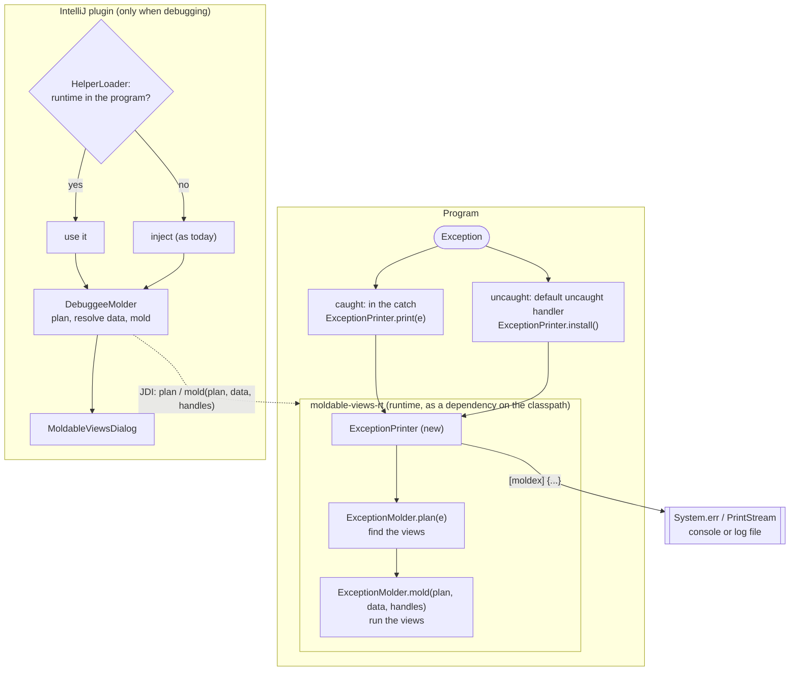
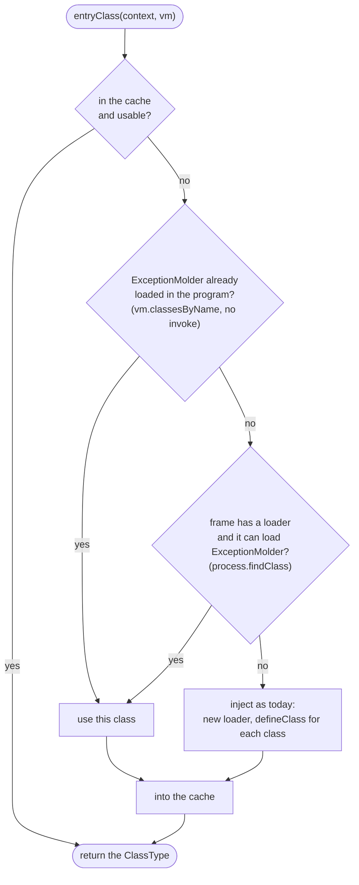
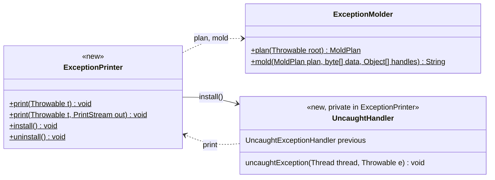
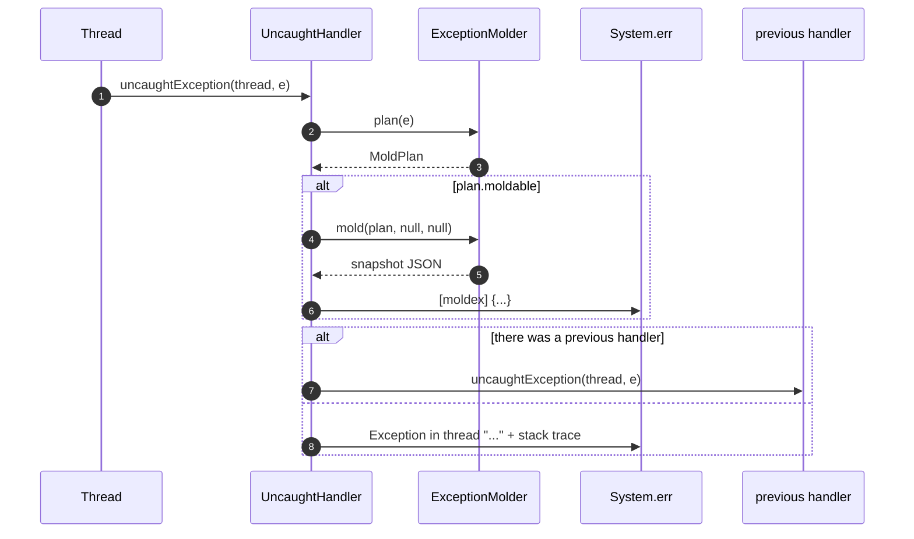

# Design: runtime in the library, views in the console

Status: design of 2026-11-09 on the branch `views-ohne-debugger`. Step 1 is implemented and was tested by hand in
`runIde` on 2026-11-10 (section 6, item 4). Step 2 was implemented on 2026-11-10, with tests in `moldable-views-rt`,
and `samples/console-demo` was run by hand with and without the debugger. Replaces
[design-views-ohne-debugger.md](design-views-ohne-debugger.md). Builds on [design-plan-mold.md](design-plan-mold.md)
(`ExceptionMolder.plan` / `mold`).

The German original of this document is [design-runtime-in-library-de.md](design-runtime-in-library-de.md).

## 0. What this is about

Today, moldable views only exist while IntelliJ is attached to the program with the debugger: the plugin injects the
runtime (`moldable-views-rt`) into the suspended program and calls it through JDI.

This design takes two steps:

1. **The runtime becomes a library.** A program can take `moldable-views-rt` as a dependency and then has the runtime
   on its own classpath. The plugin uses this runtime if it is there, and injects as it does today otherwise.
2. **The program prints the views itself.** Without a debugger, the program calls `plan` and `mold` itself and writes
   the result to the console as raw JSON.

After that, the real output decides how to go on (section 7).

The background from the paper *Moldable Exceptions* (Chiş, Gîrba, Nierstrasz, Onward! 2024): the exception supplies
its own views, and a tool only asks for them. The debugger is one consumer. The console is a second consumer of the
same views. For that, the views must be able to run where the program runs, so in the library.

## 1. Decisions

| Question | Decision |
|---|---|
| How does the runtime get into the program? | As the dependency `moldable-views-rt`. It brings `moldable-views` with it (`api`). The modules stay separate |
| Who only wants to write views | Takes `moldable-views` alone. When debugging, the plugin injects the runtime |
| Does the runtime use the types from `moldable-views`? | No. It finds views by the name of the annotation and reads by reflection (section 3.5) |
| What does the plugin do when debugging? | Runtime present in the program: use it. Otherwise: inject as today |
| Does injection stay? | Yes. Programs without the library still get views (section 3.4) |
| Versioning between plugin and runtime | None. Both come from the same repository and are built together |
| Restrictions of the runtime | As today: Java 8, JDK only. So no JSON library |
| What is printed without a debugger? | The molded views, exactly the JSON of `ExceptionMolder.mold` (the same format as with a debugger) |
| Which data do views have without a debugger? | Only the exception itself: fields, message, cause chain, `getStackTrace()` |
| `@StackFrames`, `@PsiQuery` without a debugger | The view shows `unavailable` with a reason instead of running |
| Which exceptions? | Explicit ones (`ExceptionPrinter.print(t)`, e.g. in a `catch`) and uncaught ones (`ExceptionPrinter.install()`) |
| Where to? | `System.err`, or a `PrintStream` the program passes in |
| Format | One line per exception: `[moldex] ` + snapshot JSON |
| Configuration | None. Whoever calls `print` or `install` wants the output |
| JSON or binary between runtime and plugin | Stays as today (runtime → plugin JSON, plugin → runtime binary). See section 7 |

## 2. Overview



- **One runtime, two callers.** Without a debugger, the program calls `plan` and `mold(plan, null, null)` itself. With
  a debugger, the plugin calls the same two methods through JDI and supplies the debugger data.
- **There is no new molding API.** Only `ExceptionPrinter` is new: one call of `plan` and `mold` and one line of
  output.
- **Nothing goes to IntelliJ.** Without a debugger, the program writes text to the console or to a file. IntelliJ does
  not have to exist where the program runs.

## 3. Step 1: the runtime becomes a library

### 3.1 Build

- `moldable-views-rt/build.gradle.kts`: `api(project(":moldable-views"))`. Whoever has the runtime as a dependency
  gets the annotations and `DebugViews` with it.
- `moldable-views` stays without dependencies. Whoever only wants to write views takes this module alone.
- `moldable-views-rt` stays a module of its own with its class list `META-INF/moldexj/runtime-classes`. The plugin
  needs exactly these classes for injection.
- The demos (`samples/demos`) still depend only on `moldable-views`. For them the runtime is always injected; they
  stay the test for this path.
- New: `samples/console-demo` depends on `moldable-views-rt`. It is the test that the plugin uses the program's
  runtime, and it gets the console output in step 2.

| The program has | Write views | Output to the console | When debugging |
|---|---|---|---|
| nothing | no | no | runtime is injected, built-in views only (later: view packs, section 7) |
| `moldable-views` | yes | no | runtime is injected |
| `moldable-views-rt` | yes | yes | the program's runtime is used |

### 3.2 Detect or inject (`HelperLoader`)



The flow in `HelperLoader.entryClass`:

1. **Cache** as today (per VM and class loader of the frame).
2. **Already loaded?** `vm.classesByName("ch.moldexj.runtime.ExceptionMolder")` is a pure JDI read. If there is a
   class that does not come from a loader the plugin created, it is used. For this, `HelperLoader` remembers the
   loaders it created itself.
3. **Loadable?** If the suspended frame has a class loader, `process.findClass(context, name, loader)` tries to load
   the class through it. If the library is on the classpath, this works.
4. **Otherwise inject:** today's code, unchanged.

One case still injects although the library is there: the debugger stops inside the JDK (e.g. where `java.time` throws
the `DateTimeParseException`), and the program has never used the runtime up to then. The frame then has the bootstrap
loader, which does not see the library. This is harmless: the runtime holds no state, and both copies are the same
code. If the program has printed an exception before, item 2 applies.

### 3.3 What changes for the runtime

Nothing in the code. The runtime already looks for views through `Reflection.classLoaders()` (its own loader and the
thread's context class loader). When it runs from the library, its own loader is the program's, and it finds the same
manifests.

Only the comments are no longer right: `ExceptionMolder`, `Reflection` and `build.gradle.kts` describe the runtime as
"runs only in the debugged program, injected by the plugin". New: "runs in the program, either as a library or
injected by the plugin".

### 3.4 Why injection stays

- **Views for foreign exceptions:** static views for exceptions from the JDK or from libraries (regex, date, Mockito)
  can be on the classpath through a manifest without the program having `moldable-views` as a dependency.
- **Views without the runtime in the program:** a program that only has `moldable-views` should still get its views
  when debugging.
- **The code exists and works.**

The price: the runtime must keep working with Java 8 and the JDK only.

### 3.5 Direction of the dependency, and duck typing

In the build, the runtime depends on `moldable-views`, but its code uses **no** type from it. This looks contradictory
and is intended.

**The dependency is packaging only.** It makes one line in the build enough to write views and to print them.

**The code must not use the types.** To the JVM, a class is the same class only if the name *and* the class loader are
the same. The same class file from two loaders gives two different classes. Exactly this happens here:

- An injected runtime lives in a loader of its own, a child of the loader of the suspended frame.
- If the debugger stops inside the JDK (e.g. in the date demo), that is the bootstrap loader. The injected loader then
  does not see the program's `moldable-views` at all.
- A program with no dependency at all will later get `moldable-views` injected too (view packs), next to whatever the
  program may have itself.

If the runtime asked `method.getAnnotation(DebugView.class)` with *its* copy, it would find nothing on a view that is
annotated with the *program's* copy. The view would disappear without an error message. A cast of the result to the
runtime's `DebugViews.View` would fail in the same way.

Comparing by name and reading by reflection do not have this problem: they work with every copy in every loader. The
rules for the runtime's code:

- Find annotations through `Reflection.debugView`, never through a class literal from `moldable-views`.
- Read results through `Reflection.read` / `readString` (`ResultConverter`), never with `instanceof` or a cast.
- Pass parameters through a `java.lang.reflect.Proxy` of the view's parameter type (`ValueAdapter`).

Rejected: use the types directly and inject `moldable-views` only if the program lacks it. This fails at a stop inside
the JDK (second point above). The injected loader would have to be attached to a different loader, and that becomes
unreliable for programs with several class loaders.

That a project can declare its own `@DebugView` follows from the same mechanism, but it is no longer a goal and is not
tested separately.

This is also documented in `moldable-views-rt/README.md` ("Why duck typing"), in the Javadoc of `ExceptionMolder` and
in `moldable-views-rt/build.gradle.kts`.

## 4. Step 2: raw JSON to the console

### 4.1 Classes



`ExceptionPrinter` sits next to `ExceptionMolder` in `ch.moldexj.runtime`. No further classes are needed. The class
ends up in the class list automatically and is defined along with the others on injection. That does no harm; the
plugin never calls it.

### 4.2 `ExceptionMolder.mold`: `data == null` means "no debugger"

Before this step, `mold(plan, null, null)` already almost worked. But if the plan has requests (a view wants
`@StackFrames`), `mold` wrote the misleading note "The debugger sent 0 values for 1 requests." and the reason "The
debugger did not send this value.".

New:

- `data == null`: there is no debugger. Every request gets an `Unavailable` with the reason *"This view needs data
  from the debugger (for example @StackFrames). Without a debugger, a view only sees the exception itself."* No note.
- `data != null`: as before.

Nothing changes for the plugin. It passes `null` only when the plan has no requests. The JSON keeps exactly its
format, without new fields.

`@StackFrames` is not half-filled from `getStackTrace()` (class, method, line, but empty locals). A view that reads
`frame.local("cart")` would otherwise get `null` and show "no data" instead of "not available". Every view has the
stack trace anyway through `@Exception` and `e.getStackTrace()`. The paper knows the same case: the diff view of
`AssertionFailure` first checks `gtHasStack` and returns an empty view otherwise.

### 4.3 `ExceptionPrinter`

```java
/** Prints the moldable views of an exception without a debugger, as one JSON line. */
public final class ExceptionPrinter {

    /** Prints the views of t's chain to System.err. Never throws. */
    public static void print(Throwable t);

    /** Prints the views of t's chain to out, e.g. a log file. Never throws. */
    public static void print(Throwable t, PrintStream out);

    /** JVM-wide default uncaught-exception handler: prints, then calls the previous handler. */
    public static synchronized void install();

    /** Restores the previous default handler. For tests. */
    public static synchronized void uninstall();
}
```

`print(t, out)`:

1. `plan = ExceptionMolder.plan(t)`
2. `json = ExceptionMolder.mold(plan, null, null)`
3. `out.println("[moldex] " + json)`. One `println` writes the whole line at once; lines from several threads do not
   mix.
4. Everything in `try/catch (Throwable)`. If something goes wrong, a short line with the reason is written to `out`,
   never an exception to the caller.

`print` always prints, also when the exception has no views of its own (then only the built-in views Details,
Stack trace, Fields).

A view that throws does not cause an endless loop: `ViewRunner` already catches that and turns it into a tab of kind
`error`.

### 4.4 Uncaught handler



- `Thread.setDefaultUncaughtExceptionHandler` is **JVM-wide**. It applies to all threads without a handler of their
  own, including `main` and the Swing EDT. There is no need to hook into each thread.
- `install()` remembers the previous default handler and calls it afterwards.
- **If there was no previous handler, the handler prints the stack trace itself**, the way the JVM otherwise does
  (`Exception in thread "main" …`). It must not call `thread.getThreadGroup().uncaughtException(...)` for this: that
  method calls the default handler again, so itself, and that would be an endless loop.
- The handler prints the `[moldex]` line only if `plan.moldable`. Otherwise every uncaught exception would have the
  built-in views in the console in addition to the stack trace.
- Calling `install()` twice installs only once.
- Limit: exceptions that the program or a framework catches do not arrive here. For those there is `print(e)` in the
  `catch`.

If the program runs with `install()` under the debugger, both happen: the plugin stops at the uncaught exception and
shows the dialog, and after resuming, the handler writes the line to the console.

### 4.5 Output

One line per exception, with the prefix `[moldex] `, so that the lines can be found in mixed output:

```
[moldex] {"chain":[{"label":"Exception","depth":0,"type":"java.time.format.DateTimeParseException","message":"Text '2026-13-01' could not be parsed ...","moldable":true,"views":[...]}],"notes":[]}
```

`Json.string` escapes `\n`, `\r`, `\t` and control characters, so a view with multi-line text stays one line.

### 4.6 Samples

Each of the two paths has its own project, so that neither depends on where the debugger happens to stop:

| Project | Dependency | When debugging | Console |
|---|---|---|---|
| `samples/demos` | `moldable-views` | runtime is injected | no, the program lacks the runtime |
| `samples/console-demo` | `moldable-views-rt` | the program's runtime is used | yes |

`samples/console-demo` throws an `OrderRejectedException` with a table view. Its `main` calls
`ExceptionPrinter.install()`, prints a caught exception with `print(e)` and then throws an uncaught one. This way the
same program can be run with and without a debugger and both results compared. If more cases are needed for this (a
view for a JDK exception, one with `@StackFrames`), they go into this sample.

`samples/demos` stays unchanged and does not call `install()`. As an aside: the entry `mainClass = "demo.Main"` in its
`build.gradle.kts` points nowhere; every demo has its own `main`.

## 5. What works without a debugger

Locals and stack frames only exist while the frames are still on the thread, so at the throw. Without a debugger, a
view only sees the exception. The reasoning (`LiveStackFrame`, `athrow` agent, JVMTI, the regex example) is in
[design-views-ohne-debugger.md](design-views-ohne-debugger.md), section 2, and still holds.

| Demo | View | Needs | Without a debugger |
|---|---|---|---|
| Constraints | Violations | `@Exception` | yes |
| Date | Parse position, Other formats | `@Exception` | yes |
| ApiContract | Diff, Mismatches, Request | instance view (the exception itself) | yes |
| PDF | Diff | instance view | yes (prints two file paths) |
| Regex | Pattern | `@Exception` | yes |
| Regex | Parser, Fix | `@StackFrames(fields = true)` | no |
| Mockito | Matchers, Calls | `@StackFrames` (+ `@PsiQuery`) | no |
| all | Details, Stack trace, Fields (built-in) | the exception | yes |

Further limits:

- **Point in time:** the views run where `print` is called, or in the uncaught handler, not at the throw. If an
  instance view reads objects the exception points to, `finally` blocks may have changed them in the meantime.
- **Cost in the program:** views now run in the program's flow. They should be fast and free of side effects (this
  was already the rule).
- **Format:** the JSON is built for the dialog (`priority`, highlight spans with offsets, styles). Whether it suits
  humans or an AI as it is, only the output shows.

## 6. Implementation steps

**Step 1: the runtime becomes a library**

1. `moldable-views-rt`: `api(project(":moldable-views"))`. New sample `samples/console-demo` with the runtime as a
   dependency.
2. `HelperLoader.entryClass`: look in the program first (loaded, then loadable), otherwise inject. Remember the
   loaders it created itself.
3. Adapt the comments in `ExceptionMolder`, `Reflection`, `HelperLoader` and `moldable-views-rt/build.gradle.kts`,
   and explain the duck typing in the READMEs (section 3.5).
4. **Test in `runIde`** (also the first real run of `plan`/`mold` in the IDE, which was still pending according to
   [design-plan-mold.md](design-plan-mold.md)):
   - `samples/console-demo`: the dialog shows the view "Stock", and nothing is injected (a breakpoint in
     `HelperLoader.inject` is **not** reached).
   - `samples/demos`, stop in its own code (ApiContract, PDF): the runtime is injected, everything works as before
     this design.
   - `samples/demos`, stop inside the JDK (Date): the same.
   - `samples/demos` with `@StackFrames` (Regex "Parser"): the debugger data arrives.

**Step 2: raw JSON to the console**

5. `ExceptionMolder.mold`: `data == null` as "no debugger".
6. `ExceptionPrinter` with `print`, `install`, `uninstall`.
7. Tests in `moldable-views-rt` (set up JUnit 5, the module had no tests; the test views need the processor as
   `testAnnotationProcessor`):
   - exception with an `@Exception` view: one line with the view;
   - view with `@StackFrames`: `unavailable` with the new reason, no note;
   - `install()` and an exception in a thread: exactly one line, the previous handler was called;
   - `install()` without a previous handler: line and stack trace, no endless loop;
   - non-moldable exception in the handler: no `[moldex]` line.
8. `samples/console-demo`: `ExceptionPrinter.install()` in `main`.
9. Documentation: section "Without a debugger" in the README. This document in English, with the German original
   kept as `design-runtime-in-library-de.md`.

Then stop and look at the output of `samples/console-demo`.

## 7. Later (not part of this design)

- **View packs (next step after the console):** write views for exceptions from the JDK (regex, date) once in a
  module of their own, e.g. `moldable-views-jdk`. The plugin ships the module and injects it together with
  `moldable-views` and the runtime into a program that has none of them. This way every program gets these views
  without a dependency. To be solved:
  - Injected classes have no resources. The plugin has to pass the text of the view manifest to the runtime itself.
  - Whatever is injected must run on Java 8. The demos are set to Java 21 today.
  - If the pack is already on the classpath, it is found through its manifest and not injected again.
- **Model instead of string JSON:** today `ViewRunner` and `ViewJson` assemble the JSON from strings. A small model
  (snapshot, node, view as objects) with separate writers would be cleaner. The tests from step 2 secure this
  rework.
- **Text writer:** the views readable in the console, built on the model.
- **Binary instead of JSON between runtime and plugin:** with the model, this would be one more writer. JSON stays
  necessary for the console anyway, so binary would be an addition and not a unification.
- **AI:** the `[moldex]` lines as context for an agent, compared with "stack trace only".
- **Further hooks:** a logger adapter (most exceptions are caught and logged) and a JUnit extension (JUnit catches the
  exception of a failed test itself). Both only call `print`.
- **Java agent:** brings the runtime into a program without a dependency and calls `install()`.
- **Action "Accept":** replace the expected test data with the new data, as in the PDF case study of the paper
  (section 6).

Rejected: a launcher of its own that controls the program through JDI without IntelliJ. It would supply locals, but it
is new debugger infrastructure and not the topic of this work.

## 8. Open questions

- **Uncaught handler only for `moldable`?** Proposed this way. Alternative: always, then also with the built-in views.
- **Prefix `[moldex]`:** keep it, or pure JSON?
- **Name:** `ExceptionPrinter`? Alternatives: `MoldedOutput`, `ConsoleMolder`.
- **Stop inside the JDK before the first use:** is injecting there enough (section 3.2)? The alternative would be to
  look for the runtime through the thread's context class loader, with one additional call in the program.
