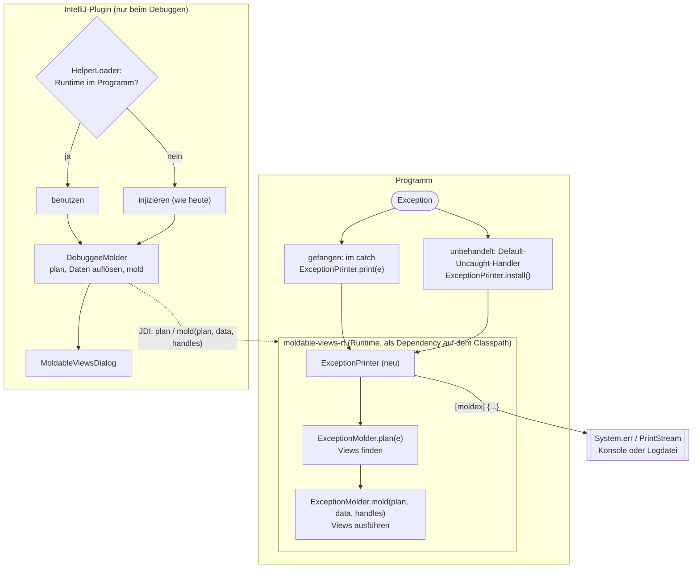
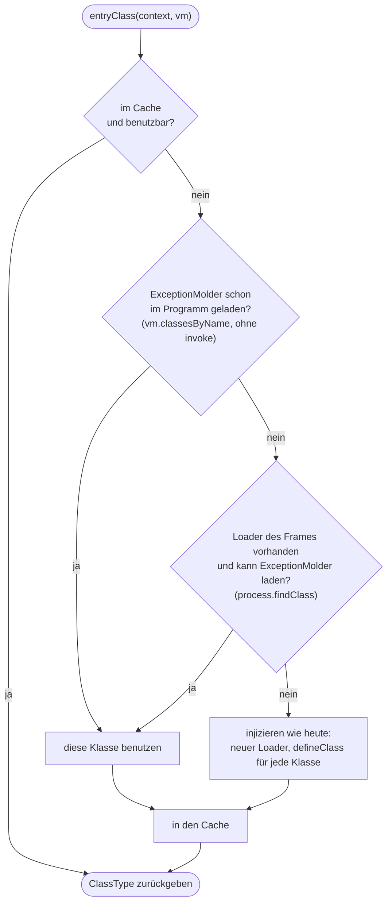
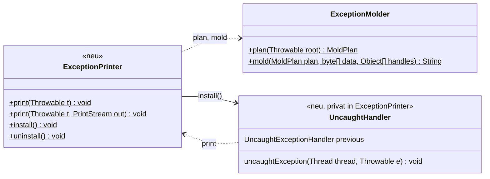
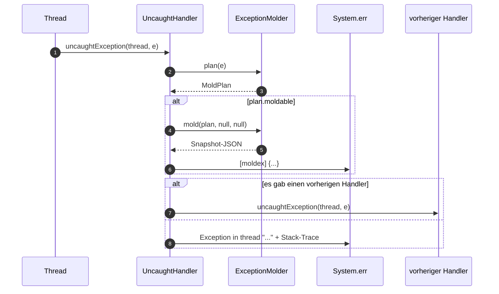

# Entwurf: Runtime in der Library, Views in der Konsole

Status: Entwurf vom 2026-11-09 auf dem Branch `views-ohne-debugger`. Schritt 1 ist umgesetzt und am 2026-11-10 in
`runIde` von Hand getestet (Abschnitt 6, Punkt 4). Schritt 2 ist noch nicht umgesetzt. Löst
[design-views-ohne-debugger.md](design-views-ohne-debugger.md) ab. Baut auf [design-plan-mold.md](design-plan-mold.md)
auf (`ExceptionMolder.plan` / `mold`).

## 0. Worum es geht

Heute entstehen Moldable Views nur, wenn IntelliJ mit dem Debugger am Programm hängt: Das Plugin injiziert die Runtime
(`moldable-views-rt`) in das angehaltene Programm und ruft sie über JDI auf.

Dieser Entwurf macht zwei Schritte:

1. **Die Runtime wird eine Library.** Ein Programm kann `moldable-views-rt` als Dependency nehmen und hat die Runtime
   damit selbst auf dem Classpath. Das Plugin benutzt diese Runtime, wenn sie da ist, und injiziert sonst wie heute.
2. **Das Programm gibt die Views selbst aus.** Ohne Debugger ruft das Programm `plan` und `mold` selbst auf und
   schreibt das Ergebnis als rohes JSON in die Konsole.

Danach wird anhand der echten Ausgabe entschieden, wie es weitergeht (Abschnitt 7).

Der Hintergrund aus dem Paper *Moldable Exceptions* (Chiş, Gîrba, Nierstrasz, Onward! 2024): Die Exception liefert
ihre Views selbst, und ein Werkzeug fragt sie nur ab. Der Debugger ist dabei ein Abnehmer. Die Konsole ist ein zweiter
Abnehmer derselben Views. Dafür müssen die Views dort laufen können, wo das Programm läuft, also in der Library.

## 1. Entscheidungen

| Frage | Entscheidung |
|---|---|
| Wie kommt die Runtime ins Programm? | Als Dependency `moldable-views-rt`. Sie bringt `moldable-views` mit (`api`). Die Module bleiben getrennt |
| Wer nur Views schreiben will | Nimmt `moldable-views` allein. Beim Debuggen injiziert das Plugin die Runtime |
| Benutzt die Runtime die Typen aus `moldable-views`? | Nein. Sie findet Views über den Namen der Annotation und liest per Reflection (Abschnitt 3.5) |
| Was macht das Plugin beim Debuggen? | Runtime im Programm vorhanden: benutzen. Sonst: injizieren wie heute |
| Bleibt das Injizieren? | Ja. Programme ohne die Library bekommen weiterhin Views (Abschnitt 3.4) |
| Versionierung zwischen Plugin und Runtime | Keine. Beide kommen aus demselben Repo und werden zusammen gebaut |
| Einschränkungen der Runtime | Wie heute: Java 8, nur JDK. Also keine JSON-Library |
| Was wird ohne Debugger ausgegeben? | Die fertig gemoldeten Views, genau das JSON von `ExceptionMolder.mold` (dasselbe Format wie mit Debugger) |
| Welche Daten haben Views ohne Debugger? | Nur die Exception selbst: Felder, Message, Cause-Kette, `getStackTrace()` |
| `@StackFrames`, `@PsiQuery` ohne Debugger | Die View zeigt `unavailable` mit Grund, statt zu laufen |
| Welche Exceptions? | Explizit (`ExceptionPrinter.print(t)`, z. B. im `catch`) und unbehandelte (`ExceptionPrinter.install()`) |
| Wohin? | `System.err`, oder ein `PrintStream`, den das Programm übergibt |
| Format | Eine Zeile pro Exception: `[moldex] ` + Snapshot-JSON |
| Konfiguration | Keine. Wer `print` oder `install` aufruft, will die Ausgabe |
| JSON oder Binär zwischen Runtime und Plugin | Bleibt wie heute (Runtime → Plugin JSON, Plugin → Runtime binär). Siehe Abschnitt 7 |

## 2. Gesamtbild



- **Eine Runtime, zwei Aufrufer.** Ohne Debugger ruft das Programm `plan` und `mold(plan, null, null)` selbst auf. Mit
  Debugger ruft das Plugin dieselben zwei Methoden über JDI auf und liefert die Debugger-Daten mit.
- **Es gibt keine neue Molding-API.** Neu ist nur `ExceptionPrinter`: ein Aufruf von `plan` und `mold` und eine Zeile
  Ausgabe.
- **Nichts geht an IntelliJ.** Ohne Debugger schreibt das Programm Text in die Konsole oder in eine Datei. IntelliJ
  muss dort, wo das Programm läuft, nicht vorhanden sein.

## 3. Schritt 1: Runtime in die Library

### 3.1 Build

- `moldable-views-rt/build.gradle.kts`: `api(project(":moldable-views"))`. Wer die Runtime als Dependency hat,
  bekommt die Annotationen und `DebugViews` mit.
- `moldable-views` bleibt ohne Abhängigkeiten. Wer nur Views schreiben will, nimmt dieses Modul allein.
- `moldable-views-rt` bleibt ein eigenes Modul mit seiner Klassenliste `META-INF/moldexj/runtime-classes`. Das Plugin
  braucht genau diese Klassen zum Injizieren.
- Die Demos (`samples/demos`) hängen weiter nur von `moldable-views` ab. Bei ihnen wird immer injiziert, sie bleiben
  der Test für diesen Weg.
- Neu: `samples/console-demo` hängt von `moldable-views-rt` ab. Es ist der Test dafür, dass das Plugin die Runtime des
  Programms benutzt, und bekommt in Schritt 2 die Ausgabe in die Konsole.

| Das Programm hat | Views schreiben | Ausgabe in die Konsole | Beim Debuggen |
|---|---|---|---|
| nichts | nein | nein | Runtime wird injiziert, nur Built-in Views (später: View-Packs, Abschnitt 7) |
| `moldable-views` | ja | nein | Runtime wird injiziert |
| `moldable-views-rt` | ja | ja | Runtime des Programms wird benutzt |

### 3.2 Erkennen oder injizieren (`HelperLoader`)



Der Ablauf in `HelperLoader.entryClass`:

1. **Cache** wie heute (pro VM und Class Loader des Frames).
2. **Schon geladen?** `vm.classesByName("ch.moldexj.runtime.ExceptionMolder")` ist ein reiner JDI-Lesezugriff. Gibt es
   eine Klasse, die nicht aus einem vom Plugin angelegten Loader stammt, wird sie benutzt. Dafür merkt sich
   `HelperLoader` die Loader, die er selbst angelegt hat.
3. **Ladbar?** Hat der angehaltene Frame einen Class Loader, versucht `process.findClass(context, name, loader)`, die
   Klasse darüber zu laden. Liegt die Library auf dem Classpath, klappt das.
4. **Sonst injizieren:** der heutige Code, unverändert.

Ein Fall bleibt beim Injizieren, obwohl die Library da ist: Der Debugger hält im JDK an (z. B. dort, wo `java.time` die
`DateTimeParseException` wirft), und das Programm hat die Runtime bis dahin noch nie benutzt. Der Frame hat dann den
Bootstrap-Loader, der die Library nicht sieht. Das ist harmlos: Die Runtime hält keinen Zustand, und beide Kopien sind
derselbe Code. Hat das Programm vorher schon eine Exception ausgegeben, greift Punkt 2.

### 3.3 Was sich für die Runtime ändert

Am Code nichts. Die Runtime sucht Views schon heute über `Reflection.classLoaders()` (eigener Loader und
Context-Class-Loader des Threads). Läuft sie aus der Library, ist ihr eigener Loader der des Programms, und sie findet
dieselben Manifeste.

Nur die Kommentare stimmen nicht mehr: `ExceptionMolder`, `Reflection` und `build.gradle.kts` beschreiben die Runtime
als „läuft nur im debuggten Programm, vom Plugin injiziert“. Neu: „läuft im Programm, entweder als Library oder vom
Plugin injiziert“.

### 3.4 Warum das Injizieren bleibt

- **Views für fremde Exceptions:** Statische Views für Exceptions aus dem JDK oder aus Libraries (Regex, Date, Mockito)
  können über ein Manifest auf dem Classpath liegen, ohne dass das Programm `moldable-views` als Dependency hat.
- **Views ohne Runtime im Programm:** Ein Programm, das nur `moldable-views` hat, soll beim Debuggen trotzdem seine
  Views bekommen.
- **Der Code existiert und funktioniert.**

Der Preis: Die Runtime muss weiter mit Java 8 und nur dem JDK auskommen.

### 3.5 Richtung der Abhängigkeit und Duck-Typing

Die Runtime hängt im Build von `moldable-views` ab, benutzt in ihrem Code aber **keinen** Typ daraus. Das sieht
widersprüchlich aus und ist Absicht.

**Die Abhängigkeit ist nur Verpackung.** Sie sorgt dafür, dass eine Zeile im Build reicht, um Views zu schreiben und
auszugeben.

**Der Code darf die Typen nicht benutzen.** Für die JVM ist eine Klasse nur dann dieselbe, wenn Name *und* Class Loader
gleich sind. Dieselbe Klassendatei aus zwei Loadern ergibt zwei verschiedene Klassen. Genau das kommt hier vor:

- Eine injizierte Runtime lebt in einem eigenen Loader, einem Kind des Loaders des angehaltenen Frames.
- Hält der Debugger im JDK an (z. B. bei der Date-Demo), ist das der Bootstrap-Loader. Der injizierte Loader sieht das
  `moldable-views` des Programms dann gar nicht.
- Ein Programm ganz ohne Dependency bekommt später auch `moldable-views` injiziert (View-Packs), neben dem, was das
  Programm vielleicht selbst hat.

Würde die Runtime mit *ihrer* Kopie `method.getAnnotation(DebugView.class)` fragen, fände sie an einer View, die mit
der Kopie *des Programms* annotiert ist, nichts. Die View verschwände ohne Fehlermeldung. Ein Cast des Ergebnisses auf
`DebugViews.View` der Runtime schlüge genauso fehl.

Der Vergleich über den Namen und das Lesen per Reflection haben dieses Problem nicht: Sie funktionieren mit jeder
Kopie in jedem Loader. Die Regeln für den Code der Runtime:

- Annotationen über `Reflection.debugView` finden, nie über ein Klassenliteral aus `moldable-views`.
- Ergebnisse über `Reflection.read` / `readString` lesen (`ResultConverter`), nie mit `instanceof` oder Cast.
- Parameter über einen `java.lang.reflect.Proxy` des Parametertyps der View übergeben (`ValueAdapter`).

Verworfen: die Typen direkt benutzen und `moldable-views` nur injizieren, wenn es im Programm fehlt. Das scheitert am
Stop im JDK (zweiter Punkt oben). Man müsste den injizierten Loader an einen anderen Loader hängen, und das wird bei
Programmen mit mehreren Class Loadern unzuverlässig.

Dass ein Projekt seine eigene `@DebugView` deklarieren kann, folgt aus demselben Mechanismus, ist aber kein Ziel mehr
und wird nicht eigens getestet.

Dokumentiert ist das auch in `moldable-views-rt/README.md` („Why duck typing“), im Javadoc von `ExceptionMolder` und
in `moldable-views-rt/build.gradle.kts`.

## 4. Schritt 2: Rohes JSON in die Konsole

### 4.1 Klassen



`ExceptionPrinter` liegt neben `ExceptionMolder` in `ch.moldexj.runtime`. Weitere Klassen braucht es nicht. Die Klasse
landet automatisch in der Klassenliste und wird beim Injizieren mit definiert. Das schadet nicht, das Plugin ruft sie
nie auf.

### 4.2 `ExceptionMolder.mold`: `data == null` heißt „kein Debugger“

Heute funktioniert `mold(plan, null, null)` schon fast. Hat der Plan aber Requests (eine View will `@StackFrames`),
schreibt `mold` die irreführende Note „The debugger sent 0 values for 1 requests.“ und als Grund „The debugger did not
send this value.“.

Neu:

- `data == null`: Es gibt keinen Debugger. Jeder Request bekommt ein `Unavailable` mit dem Grund *„This view needs
  data from the debugger (for example @StackFrames). Without a debugger, a view only sees the exception itself.“*
  Keine Note.
- `data != null`: wie heute.

Für das Plugin ändert sich nichts. Es übergibt `null` nur, wenn der Plan keine Requests hat. Das JSON bleibt genau
das heutige Format, ohne neue Felder.

`@StackFrames` wird dabei nicht halb aus `getStackTrace()` gefüllt (Klasse, Methode, Zeile, aber leere Locals). Eine
View, die `frame.local("cart")` liest, bekäme sonst `null` und würde „keine Daten“ statt „nicht verfügbar“ zeigen. Den
Stack-Trace hat jede View ohnehin über `@Exception` und `e.getStackTrace()`. Das Paper kennt denselben Fall: Die
Diff-View von `AssertionFailure` prüft zuerst `gtHasStack` und liefert sonst eine leere View.

### 4.3 `ExceptionPrinter`

```java
/** Prints the moldable views of an exception without a debugger, as one JSON line. */
public final class ExceptionPrinter {

    /** Prints the views of t's chain to System.err. Never throws. */
    public static void print(Throwable t);

    /** Prints the views of t's chain to out, e.g. a log file. Never throws. */
    public static void print(Throwable t, PrintStream out);

    /** JVM-wide default uncaught-exception handler: prints, then calls the previous handler. */
    public static synchronized void install();

    /** Restores the previous default handler. For tests. */
    public static synchronized void uninstall();
}
```

`print(t, out)`:

1. `plan = ExceptionMolder.plan(t)`
2. `json = ExceptionMolder.mold(plan, null, null)`
3. `out.println("[moldex] " + json)`. Ein `println` schreibt die ganze Zeile auf einmal, Zeilen aus mehreren Threads
   mischen sich nicht.
4. Alles in `try/catch (Throwable)`. Geht etwas schief, steht eine kurze Zeile mit dem Grund in `out`, nie eine
   Exception beim Aufrufer.

`print` gibt immer aus, auch wenn die Exception keine eigenen Views hat (dann nur die Built-in Views Details,
Stack trace, Fields).

Eine View, die selbst wirft, löst keine Endlosschleife aus: `ViewRunner` fängt das schon heute ab und macht daraus
ein Tab der Art `error`.

### 4.4 Uncaught-Handler



- `Thread.setDefaultUncaughtExceptionHandler` ist **JVM-weit**. Es gilt für alle Threads ohne eigenen Handler, auch für
  `main` und den Swing-EDT. Man muss sich nicht in jeden Thread einhängen.
- `install()` merkt sich den vorherigen Default-Handler und ruft ihn danach auf.
- **Gab es keinen vorherigen Handler, druckt der Handler den Stack-Trace selbst**, so wie die JVM es sonst tut
  (`Exception in thread "main" …`). Er darf dafür nicht `thread.getThreadGroup().uncaughtException(...)` aufrufen:
  Diese Methode ruft wieder den Default-Handler auf, also ihn selbst, und das wäre eine Endlosschleife.
- Der Handler gibt die `[moldex]`-Zeile nur aus, wenn `plan.moldable`. Sonst stünden bei jeder unbehandelten Exception
  die Built-in Views doppelt zum Stack-Trace in der Konsole.
- Zweimal `install()` installiert nur einmal.
- Grenze: Exceptions, die das Programm oder ein Framework fängt, kommen hier nicht an. Dafür gibt es `print(e)` im
  `catch`.

Läuft das Programm mit `install()` unter dem Debugger, passiert beides: Das Plugin hält an der unbehandelten Exception
an und zeigt den Dialog, und nach dem Fortsetzen schreibt der Handler die Zeile in die Konsole.

### 4.5 Ausgabe

Eine Zeile pro Exception, mit dem Präfix `[moldex] `, damit man die Zeilen in gemischter Ausgabe findet:

```
[moldex] {"chain":[{"label":"Exception","depth":0,"type":"java.time.format.DateTimeParseException","message":"Text '2026-13-01' could not be parsed ...","moldable":true,"views":[...]}],"notes":[]}
```

`Json.string` escaped `\n`, `\r`, `\t` und Steuerzeichen, eine View mit mehrzeiligem Text bleibt also eine Zeile.

### 4.6 Samples

Jeder der beiden Wege hat sein eigenes Projekt, damit keiner davon abhängt, wo der Debugger gerade anhält:

| Projekt | Dependency | Beim Debuggen | Konsole |
|---|---|---|---|
| `samples/demos` | `moldable-views` | Runtime wird injiziert | nein, die Runtime fehlt im Programm |
| `samples/console-demo` | `moldable-views-rt` | Runtime des Programms wird benutzt | ja |

`samples/console-demo` wirft heute eine `OrderRejectedException` mit einer Tabellen-View. In Schritt 2 ruft sein `main`
`ExceptionPrinter.install()` auf. Damit kann man dasselbe Programm mit und ohne Debugger laufen lassen und beide
Ergebnisse vergleichen. Braucht es dafür mehr Fälle (eine View für eine JDK-Exception, eine mit `@StackFrames`),
kommen sie in dieses Sample.

`samples/demos` bleibt unverändert und ruft `install()` nicht auf. Nebenbei: Der Eintrag `mainClass = "demo.Main"`
in seinem `build.gradle.kts` zeigt ins Leere, jede Demo hat ihr eigenes `main`.

## 5. Was ohne Debugger geht

Locals und Stack-Frames gibt es nur, solange die Frames noch auf dem Thread liegen, also am Throw. Ohne Debugger sieht
eine View nur die Exception. Die Begründung (`LiveStackFrame`, `athrow`-Agent, JVMTI, Beispiel Regex) steht in
[design-views-ohne-debugger.md](design-views-ohne-debugger.md), Abschnitt 2, und gilt weiter.

| Demo | View | Braucht | Ohne Debugger |
|---|---|---|---|
| Constraints | Violations | `@Exception` | ja |
| Date | Parse position, Other formats | `@Exception` | ja |
| ApiContract | Diff, Mismatches, Request | Instance-View (die Exception selbst) | ja |
| PDF | Diff | Instance-View | ja (gibt zwei Dateipfade aus) |
| Regex | Pattern | `@Exception` | ja |
| Regex | Parser, Fix | `@StackFrames(fields = true)` | nein |
| Mockito | Matchers, Calls | `@StackFrames` (+ `@PsiQuery`) | nein |
| alle | Details, Stack trace, Fields (Built-in) | die Exception | ja |

Weitere Grenzen:

- **Zeitpunkt:** Die Views laufen dort, wo `print` aufgerufen wird bzw. im Uncaught-Handler, nicht am Throw. Liest eine
  Instance-View Objekte, auf die die Exception zeigt, können `finally`-Blöcke diese inzwischen verändert haben.
- **Kosten im Programm:** Views laufen jetzt im Programmfluss. Sie sollen schnell und ohne Seiteneffekte sein (galt
  schon bisher).
- **Format:** Das JSON ist für den Dialog gebaut (`priority`, Highlight-Spans mit Offsets, Styles). Ob es so für
  Menschen oder eine AI taugt, zeigt erst die Ausgabe.

## 6. Umsetzungsschritte

**Schritt 1: Runtime in die Library**

1. `moldable-views-rt`: `api(project(":moldable-views"))`. Neues Sample `samples/console-demo` mit der Runtime als
   Dependency.
2. `HelperLoader.entryClass`: erst im Programm suchen (geladen, dann ladbar), sonst injizieren. Die selbst angelegten
   Loader merken.
3. Kommentare in `ExceptionMolder`, `Reflection`, `HelperLoader` und `moldable-views-rt/build.gradle.kts` anpassen,
   das Duck-Typing in den READMEs begründen (Abschnitt 3.5).
4. **Test in `runIde`** (zugleich der erste echte Lauf von `plan`/`mold` im IDE, der laut
   [design-plan-mold.md](design-plan-mold.md) noch aussteht):
   - `samples/console-demo`: Der Dialog zeigt die View „Stock“, und es wird **nicht** injiziert (Breakpoint in
     `HelperLoader.inject` wird nicht erreicht).
   - `samples/demos`, Stop im eigenen Code (ApiContract, PDF): Es wird injiziert, alles funktioniert wie vor diesem
     Entwurf.
   - `samples/demos`, Stop im JDK (Date): ebenso.
   - `samples/demos` mit `@StackFrames` (Regex „Parser“): Die Debugger-Daten kommen an.

**Schritt 2: Rohes JSON in die Konsole**

5. `ExceptionMolder.mold`: `data == null` als „kein Debugger“.
6. `ExceptionPrinter` mit `print`, `install`, `uninstall`.
7. Tests in `moldable-views-rt` (JUnit 5 neu einrichten, das Modul hat noch keine Tests; die Test-Views brauchen den
   Processor als `testAnnotationProcessor`):
   - Exception mit `@Exception`-View: eine Zeile mit der View;
   - View mit `@StackFrames`: `unavailable` mit dem neuen Grund, keine Note;
   - `install()` und eine Exception in einem Thread: genau eine Zeile, der vorherige Handler wurde aufgerufen;
   - `install()` ohne vorherigen Handler: Zeile und Stack-Trace, keine Endlosschleife;
   - nicht moldable Exception im Handler: keine `[moldex]`-Zeile.
8. `samples/console-demo`: `ExceptionPrinter.install()` in `main`.
9. Doku: Abschnitt „Ohne Debugger“ im README. Dieses Dokument vor dem Commit ins Englische übersetzen.

Danach anhalten und die Ausgabe von `samples/console-demo` anschauen.

## 7. Später (nicht Teil dieses Entwurfs)

- **View-Packs (nächster Schritt nach der Konsole):** Views für Exceptions aus dem JDK (Regex, Date) einmal in einem
  eigenen Modul schreiben, z. B. `moldable-views-jdk`. Das Plugin bringt das Modul mit und injiziert es zusammen mit
  `moldable-views` und der Runtime in ein Programm, das nichts davon hat. So bekommt jedes Programm diese Views ohne
  Dependency. Zu lösen:
  - Injizierte Klassen haben keine Ressourcen. Das Plugin muss den Text des View-Manifests selbst an die Runtime
    übergeben.
  - Was injiziert wird, muss mit Java 8 laufen. Die Demos sind heute auf Java 21 eingestellt.
  - Liegt das Pack schon auf dem Classpath, wird es über sein Manifest gefunden und nicht noch einmal injiziert.
- **Modell statt String-JSON:** Heute setzen `ViewRunner` und `ViewJson` das JSON aus Strings zusammen. Sauberer wäre
  ein kleines Modell (Snapshot, Knoten, View als Objekte) und getrennt davon Writer. Die Tests aus Schritt 2 sichern
  den Umbau ab.
- **Text-Writer:** die Views lesbar in der Konsole, auf dem Modell aufgebaut.
- **Binär statt JSON zwischen Runtime und Plugin:** Mit dem Modell wäre das ein weiterer Writer. JSON bleibt für die
  Konsole ohnehin nötig, Binär wäre also zusätzlich und keine Vereinheitlichung.
- **AI:** die `[moldex]`-Zeilen als Kontext für einen Agent, verglichen mit „nur Stack-Trace“.
- **Weitere Einhängepunkte:** Logger-Adapter (die meisten Exceptions werden gefangen und geloggt) und eine
  JUnit-Extension (JUnit fängt die Exception eines fehlgeschlagenen Tests selbst). Beide rufen nur `print` auf.
- **Java-Agent:** bringt die Runtime ohne Dependency in ein Programm und ruft `install()` auf.
- **Action „Accept“:** die erwarteten Testdaten durch die neuen ersetzen, wie in der PDF-Fallstudie des Papers
  (Abschnitt 6).

Verworfen: ein eigener Launcher, der das Programm ohne IntelliJ über JDI steuert. Er würde Locals liefern, ist aber
neue Debugger-Infrastruktur und nicht das Thema dieser Arbeit.

## 8. Offene Fragen

- **Uncaught-Handler nur bei `moldable`?** So vorgeschlagen. Alternative: immer, dann auch mit den Built-in Views.
- **Präfix `[moldex]`:** behalten, oder reines JSON?
- **Name:** `ExceptionPrinter`? Alternativen: `MoldedOutput`, `ConsoleMolder`.
- **Stop im JDK vor der ersten Benutzung:** Reicht es, dort zu injizieren (Abschnitt 3.2)? Die Alternative wäre, die
  Runtime über den Context-Class-Loader des Threads zu suchen, mit einem zusätzlichen Aufruf im Programm.
