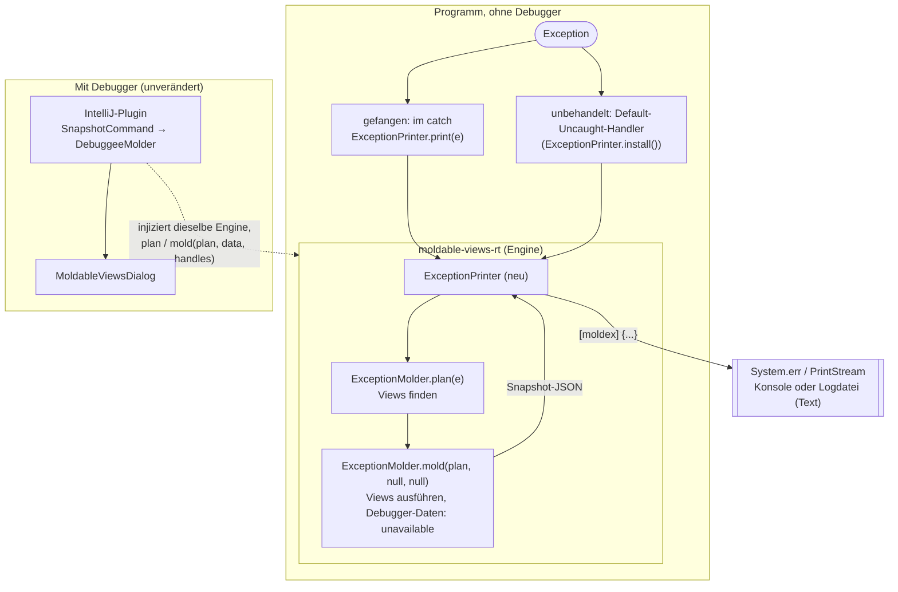
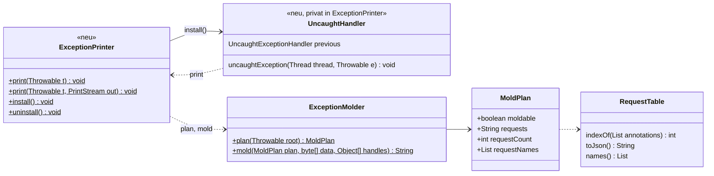
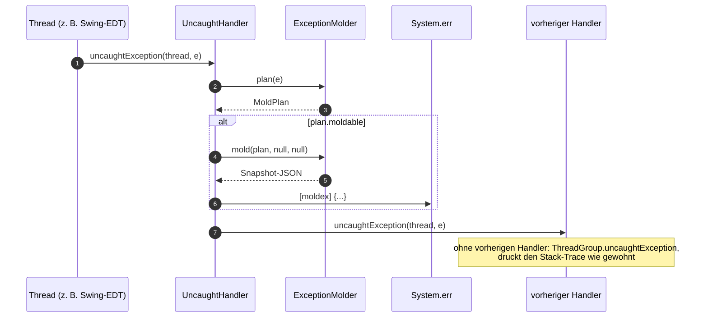

# Entwurf: Views ohne Debugger (Ausgabe in die Konsole)

Status: Entwurf vom 2026-11-09 auf dem Branch `views-ohne-debugger`, noch nicht umgesetzt. Baut auf
[design-plan-mold.md](design-plan-mold.md) auf (`ExceptionMolder.plan` / `mold`).

**Abgelöst am 2026-11-09** durch [design-runtime-in-library.md](design-runtime-in-library.md): Die Runtime kommt in die
Library, und das Plugin benutzt sie, wenn sie im Programm vorhanden ist. Abschnitt 2 (warum es ohne Debugger keine
Locals gibt) gilt weiter.

## 0. Worum es geht

Heute entstehen Moldable Views nur, wenn IntelliJ mit dem Debugger am Programm hängt. Ziel dieses Schritts: **Die Views
einer Exception auch ohne Debugger erzeugen und in die Konsole ausgeben.** Das ist die Grundlage für alles Weitere
(Logdateien, AI, Programme ohne IntelliJ).

Der Kernsatz:

> **Views werden ausgewertet, wenn der Fehler passiert.** In die Konsole kommen die fertig gemoldeten Views als JSON,
> keine Rohdaten. Eine View braucht das lebende Exception-Objekt; aus einem Stack-Trace als Text kann man nachher keine
> Views mehr erzeugen.

## 1. Entscheidungen

| Frage | Entscheidung |
|---|---|
| Was wird ausgegeben? | Die fertig gemoldeten Views, genau das JSON von `ExceptionMolder.mold` (dasselbe Format wie mit Debugger) |
| Welche Daten haben die Views ohne Debugger? | **Nur die Exception selbst:** Felder, Message, Cause-Kette, `getStackTrace()` |
| Locals, `this`, Felder fremder Objekte im Stack | Gibt es ohne Debugger nicht, siehe Abschnitt 2 |
| `@StackFrames`, `@PsiQuery` ohne Debugger | Die View zeigt `unavailable` mit Grund, statt zu laufen |
| Wo läuft das Molding? | Im Programm, mit derselben Engine (`moldable-views-rt`) wie im Debugger, ohne neue Molding-API |
| Wie kommt die Engine ins Programm? | Als normale Dependency (`moldable-views-rt`) |
| Welche Exceptions? | Explizit (`ExceptionPrinter.print(t)`, z. B. im `catch`) und unbehandelte (`ExceptionPrinter.install()`) |
| Wohin? | `System.err` (dort steht auch der Stack-Trace), oder ein `PrintStream`, den das Programm übergibt |
| Format | Eine Zeile pro Exception: `[moldex] ` + Snapshot-JSON |
| Konfiguration | Keine. Wer `print` oder `install` aufruft, will die Ausgabe |
| Plugin beim Debuggen | Unverändert: injiziert wie heute seine eigene Kopie der Engine |

## 2. Warum nur die Exception (keine Locals)

Locals und Stack-Frames gibt es nur, solange die Frames noch auf dem Thread liegen, also **am Throw**. Wer sie ohne
Debugger will, muss an jedem Throw etwas tun, ohne zu wissen, ob die Exception später gefangen wird.

### 2.1 Die Wege zu den Frames und warum sie ausscheiden

| Weg | Problem |
|---|---|
| `java.lang.LiveStackFrame` (JDK-intern) | Interne API: nicht exportiert, nur per Reflection mit `--add-opens java.base/java.lang=ALL-UNNAMED` erreichbar, kann jederzeit verschwinden. Liefert rohe Slots ohne Namen. Ohne Debugger optimiert der JIT: tote Locals sind weg, Slots werden wiederverwendet. Und es muss am Throw aufgerufen werden, beim `catch` sind die Frames abgeräumt |
| Java-Agent, der vor jedem `athrow` die Locals in ein `Object[]` packt | Läuft bei **jedem** Throw, auch bei den vielen intern gefangenen Exceptions. Sieht nur den **einen** Frame, der wirft, nicht die Frames darüber |
| JVMTI-Agent (nativ) | Kann alles (alle Frames, Locals, `catch_location` sagt sogar, ob gefangen wird). Ist aber nativer Code pro Plattform und ein eigenes Projekt |

### 2.2 Beispiel Regex

Bei `PatternSyntaxException` ist die Throw-Stelle sehr interessant: Die Views „Parser“ und „Fix“ lesen genau den
Zustand des Parsers.

- **„Parser“** braucht **alle** Frames des rekursiven Parsers von `java.util.regex.Pattern` (jeder Frame ist ein
  Konstrukt: Gruppe, Zeichenklasse, Wiederholung …) und die privaten Felder des `Pattern`-Objekts (`cursor`, `flags0`,
  `capturingGroupCount`, `namedGroups`).
- **„Fix“** braucht zusätzlich den Frame im App-Code, der die Regex-API aufgerufen hat, und dessen Variablen.

Ohne Debugger scheitert das an allen drei Stellen aus 2.1: Ein `athrow`-Hook sieht nur den innersten Parser-Frame, nicht
die Kette darüber. Das `Pattern`-Objekt hängt nicht an der Exception (`PatternSyntaxException` trägt nur Pattern, Index
und Beschreibung), ist nach dem Throw also weg. Und seine privaten Felder per Reflection zu lesen, bräuchte
`--add-opens java.base/java.util.regex=ALL-UNNAMED`. Der Debugger liest sie über JDI, ohne diese Prüfung.

### 2.3 Folge

Ohne Debugger sind Views **zu 100 % auf die Daten der Exception angewiesen**. Hat die Exception nicht genug
Information, gibt es keine View.

> Ohne Debugger ist eine Exception nur so gut wie die Daten, die sie trägt. Moldable Exceptions setzen damit einen
> Anreiz, reiche Exceptions zu bauen.

Bei den Demos:

| Demo | View | Braucht | Ohne Debugger |
|---|---|---|---|
| Constraints | Violations | `@Exception` | ja |
| Date | Parse position, Other formats | `@Exception` | ja |
| ApiContract | Diff, Mismatches, Request | Instance-View (die Exception selbst) | ja |
| PDF | Diff | Instance-View | ja (gibt zwei Dateipfade aus) |
| Regex | Pattern | `@Exception` | ja |
| Regex | Parser, Fix | `@StackFrames(fields = true)` | nein |
| Mockito | Matchers, Calls | `@StackFrames` (+ `@PsiQuery`) | nein |
| alle | Details, Stack trace, Fields (Built-in) | die Exception | ja |

`@StackFrames` wird dabei nicht halb aus `getStackTrace()` gefüllt (Klasse, Methode, Zeile, aber leere Locals). Eine
View, die `frame.local("cart")` liest, bekäme sonst `null` und würde „keine Daten“ statt „nicht verfügbar“ zeigen. Den
Stack-Trace hat jede View ohnehin über `@Exception` und `e.getStackTrace()`.

## 3. Gesamtbild



- **Eine Engine, zwei Aufrufer.** Mit Debugger ruft das Plugin `plan` und `mold` mit den Debugger-Daten auf, wie heute.
  Ohne Debugger ruft das Programm dieselben zwei Methoden selbst auf, ohne Daten.
- **Es gibt keine neue Molding-API.** Neu ist nur `ExceptionPrinter`: ein Aufruf von `plan` und `mold` und eine Zeile
  Ausgabe.
- **Nichts geht an IntelliJ.** Das Programm schreibt Text in die Konsole oder in eine Datei. IntelliJ muss dort, wo das
  Programm läuft, nicht vorhanden sein.

## 4. Umsetzung im Detail

### 4.1 Klassen (`moldable-views-rt`, Java 8, keine Abhängigkeiten)



Pakete: `ExceptionPrinter` liegt neben `ExceptionMolder` in `ch.moldexj.runtime`. Weitere Klassen braucht es nicht.

`ExceptionPrinter` landet automatisch in `META-INF/moldexj/runtime-classes` und wird beim Debuggen mit injiziert. Das
schadet nicht: Die Klasse ist Java 8, nur JDK, und das Plugin ruft sie nie auf.

### 4.2 `ExceptionMolder.mold`: `null` heißt „kein Debugger“

Heute funktioniert `mold(plan, null, null)` schon fast. Hat der Plan aber Requests (eine View will `@StackFrames`),
schreibt `mold` die irreführende Note „The debugger sent 0 values for 1 requests.“ und als Grund „The debugger did not
send this value.“.

Neu:

1. `data == null` bedeutet: Es gibt keinen Debugger. Dann bekommt jeder Request ein `Unavailable` mit einem Grund, der
   die Annotation nennt, z. B. *„This view needs @StackFrames, which only the debugger can provide. Without a debugger,
   a view only sees the exception itself.“* Keine Note.
2. `data != null` wie heute (Werte des Plugins lesen, bei falscher Anzahl die Note).
3. Dafür merkt sich `RequestTable` pro Request die Namen der Annotationen (heute nur den JSON-Text), und `MoldPlan`
   gibt sie als `requestNames` weiter.
4. Der Snapshot bekommt ein Feld `"version":1` vor `"chain"`. Gson im Plugin ignoriert es.

Signatur und Verhalten für das Plugin bleiben gleich. Das Plugin übergibt `null` nur, wenn der Plan keine Requests hat
(dann ist die Liste leer, wie heute).

### 4.3 `ExceptionPrinter`

```java
/** Prints the moldable views of an exception without a debugger, as one JSON line. */
public final class ExceptionPrinter {

    /** Prints the views of t's chain to System.err. Never throws. */
    public static void print(Throwable t);

    /** Prints the views of t's chain to out, e.g. a log file. Never throws. */
    public static void print(Throwable t, PrintStream out);

    /** JVM-wide default uncaught-exception handler: prints, then calls the previous handler. */
    public static synchronized void install();

    /** Restores the previous default handler. For tests. */
    public static synchronized void uninstall();
}
```

`print(t, out)`:

1. `plan = ExceptionMolder.plan(t)`
2. `json = ExceptionMolder.mold(plan, null, null)`
3. `out.println("[moldex] " + json)`. Ein `println` schreibt die ganze Zeile auf einmal, Zeilen aus mehreren Threads
   mischen sich nicht.
4. Alles in `try/catch (Throwable)`. Geht etwas schief, steht eine kurze Zeile mit dem Grund in `out`, nie eine
   Exception beim Aufrufer.

`print` gibt immer aus, auch wenn die Exception keine eigenen Views hat (dann nur die Built-in Views Details,
Stack trace, Fields): Wer `print` aufruft, will die Ausgabe.

Eine View, die selbst wirft, kann keine Endlosschleife auslösen: `ViewRunner` fängt das schon heute ab und macht daraus
ein Tab der Art `error`. Ein Schutz gegen Rekursion braucht es erst mit einem Logger-Adapter (Abschnitt 7).

### 4.4 Uncaught-Handler



- `Thread.setDefaultUncaughtExceptionHandler` ist **JVM-weit**. Es gilt für alle Threads ohne eigenen Handler, auch für
  den Swing-EDT (eine Exception im EDT geht dorthin, danach startet Swing den EDT neu). Man muss sich nicht in jeden
  Thread einhängen.
- `install()` merkt sich den vorherigen Default-Handler und ruft ihn danach auf. Gab es keinen, ruft er
  `thread.getThreadGroup().uncaughtException(thread, e)` auf, das normale Verhalten der JVM.
- Der Handler gibt nur aus, wenn `plan.moldable`. Sonst stünden bei jeder unbehandelten Exception die Built-in Views
  doppelt zum Stack-Trace in der Konsole.
- Zweimal `install()` installiert nur einmal.
- Grenze: Exceptions, die das Programm fängt und nur loggt, kommen hier nicht an. Dafür gibt es `print(e)` im `catch`
  und später den Logger-Adapter.

### 4.5 Ausgabe

Eine Zeile pro Exception, mit dem Präfix `[moldex] `, damit man die Zeilen in gemischter Ausgabe (Stack-Traces,
eigene Logs) findet, z. B. mit `grep`:

```
[moldex] {"version":1,"chain":[{"label":"Exception","depth":0,"type":"java.time.format.DateTimeParseException","message":"Text '2026-13-01' could not be parsed ...","moldable":true,"views":[...]}],"notes":[]}
```

`Json.string` escaped `\n`, `\r`, `\t` und Steuerzeichen, eine View mit mehrzeiligem Text bleibt also eine Zeile.

### 4.6 Build und Samples

- `moldable-views-rt` bleibt Java 8 ohne Abhängigkeiten und wird zusätzlich als normale Library benutzt:
  `implementation(project(":moldable-views-rt"))`.
- Die Demos (`samples/demos`) bekommen die Dependency und rufen in `Main` `ExceptionPrinter.install()` auf, damit man
  sie ohne Debugger laufen lassen kann.
- Neues kleines Sample `samples/swing-demo`: ein Fenster mit Knöpfen, die eine Exception im EDT werfen (Date-Parse,
  Regex, eine eigene Exception mit Instance-View), und einer, der sie fängt und `print(e)` aufruft.

## 5. Grenzen

- **Zeitpunkt:** Die Views laufen dort, wo `print` aufgerufen wird bzw. im Uncaught-Handler, nicht am Throw. Liest eine
  Instance-View Objekte, auf die die Exception zeigt, können `finally`-Blöcke diese inzwischen verändert haben. Bei
  Exceptions, die ihre Daten als eigene Felder kopieren (alle Demos), spielt das keine Rolle.
- **Kosten im Programm:** Views laufen jetzt im Programmfluss. Sie sollen schnell und ohne Seiteneffekte sein (galt
  schon bisher). Die bestehenden Limits (`ChainWalker`, `Safe`, `ResultConverter`) gelten weiter, `ViewCatalog` liest
  die Manifeste nur beim ersten Mal.
- **Dateien:** Die PDF-Diff-View gibt nur zwei Pfade aus. Den Vergleich der Dateien macht heute erst das Plugin.

## 6. Umsetzungsschritte

1. **Runtime:** `RequestTable.names()`, `MoldPlan.requestNames`, `mold` mit `data == null` als „kein Debugger“,
   `"version":1` im Snapshot.
2. **Runtime:** `ExceptionPrinter` mit `print`, `install`, `uninstall`.
3. **Tests** in `moldable-views-rt` (JUnit 5 neu einrichten, das Modul hat noch keine Tests):
   - Exception mit `@Exception`-View → eine Zeile mit der View;
   - View mit `@StackFrames` → `unavailable` mit dem neuen Grund, keine Note;
   - `install()` und eine Exception in einem Thread → genau eine Zeile, der vorherige Handler wurde aufgerufen;
   - nicht moldable Exception im Handler → keine Zeile.
4. **Plugin:** ein Test, der eine ausgegebene Zeile (ohne Präfix) mit Gson in `ExceptionSnapshot` liest.
5. **Samples:** Demos mit `install()`, neues `samples/swing-demo`.
6. **Gegenprobe mit Debugger** (`runIde`): eine App debuggen, die `moldable-views-rt` selbst auf dem Classpath hat. Der
   Dialog muss unverändert funktionieren (die injizierte Kopie lebt in ihrem eigenen Class Loader).
7. **Doku:** Abschnitt „Ohne Debugger“ in `moldable-views-rt/README.md` und im Haupt-README.

## 7. Nächste Schritte (nicht Teil dieses Entwurfs)

- **Text-Ausgabe:** Die Views zusätzlich lesbar als Text/Markdown, zuschaltbar. Entweder im Programm (ein
  Zwischenmodell statt JSON-Strings in `ViewRunner`/`ViewJson`) oder außerhalb aus der JSON-Zeile.
- **Logger-Adapter:** Die meisten Exceptions werden gefangen und geloggt. Ein Adapter (Logback, Log4j2, JUL) ruft
  `print` für jedes geloggte `Throwable`. Dann braucht es einen Schutz gegen Rekursion (eine View loggt selbst eine
  Exception). Adapter mit Abhängigkeiten kommen in eigene Module.
- **Java-Agent:** Bringt die Engine in ein Programm ohne Dependency (`-javaagent:…`) und ruft `install()` auf. Erfasst
  keine Locals (Abschnitt 2).
- **View-Packs:** Generische Views (Regex, Date, …) als eigene Jars mit Manifest, die man in jedes Projekt nehmen kann.
- **AI:** Die JSON-Zeilen als Kontext für einen AI-Agent, verglichen mit „nur Stack-Trace“.

## 8. Offene Fragen

- **Name:** `ExceptionPrinter`? Alternativen: `MoldedOutput`, `ConsoleMolder`.
- **Uncaught-Handler nur bei `moldable`?** So vorgeschlagen. Alternative: immer, dann auch mit den Built-in Views.
- **Präfix `[moldex]`:** behalten, oder reines JSON?
