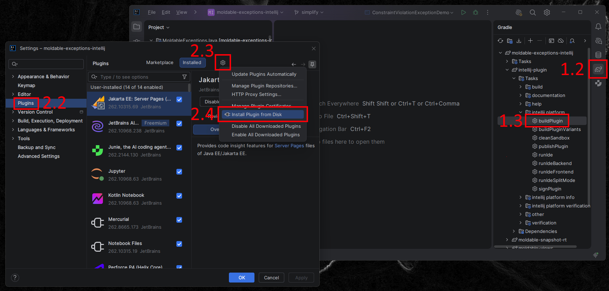

# Workaround: Install the Plugin Manually

If you can't test the plugin through `runIde` (due to the IDE not opening correctly), 
build it yourself and install it into your regular IntelliJ from disk.

## 1. Build the plugin

1. Open the Moldable Exceptions project in IntelliJ.
2. Open the **Gradle** tool window.
3. Run **intellij-plugin › Tasks › intellij platform › buildPlugin**.

This produces `intellij-plugin/build/distributions/intellij-plugin.zip`.

## 2. Install it from disk

1. Open **Settings** (`Ctrl+Alt+S`).
2. Select **Plugins** on the left.
3. Click the gear icon ⚙ next to the **Installed** tab.
4. Choose **Install Plugin from Disk…**.
5. Go to `<project root>/intellij-plugin/build/distributions/` and select
   `intellij-plugin.zip`.
6. Restart IntelliJ when prompted.

