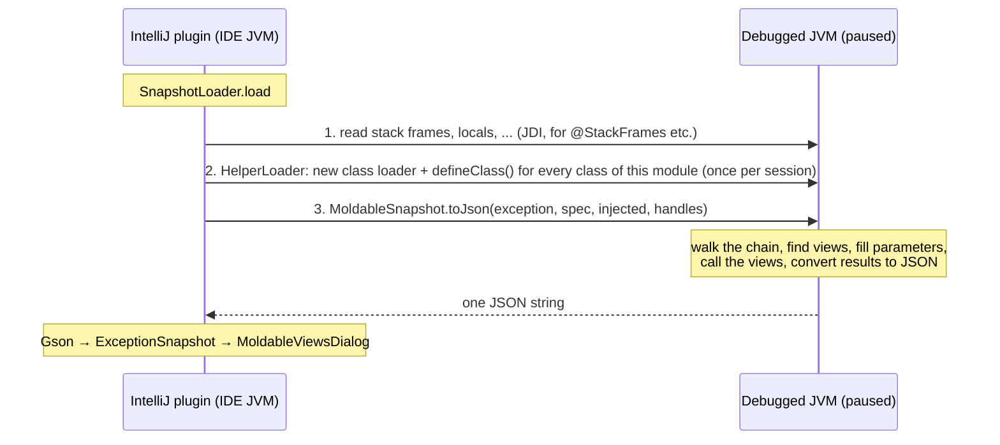

# moldable-snapshot-rt

The code that runs **inside the program being debugged**. When the debugger is paused at an exception, the IntelliJ
plugin injects this module into the paused JVM, calls one method, and gets back one JSON string describing the
exception chain and every view of every exception in it. The plugin only draws what that JSON says.

If you remember one thing: **the plugin does the debugger work, this module does the reflection work.** The plugin
can read stack frames and local variables (JDI); only code running in the debuggee can call `@DebugView` methods.

## Contents

- [The big picture](#the-big-picture)
- [Why it looks complicated](#why-it-looks-complicated)
- [One snapshot, step by step](#one-snapshot-step-by-step)
- [The three inputs](#the-three-inputs)
- [Where views come from](#where-views-come-from)
- [Running a view](#running-a-view)
- [The output JSON](#the-output-json)
- [Class by class](#class-by-class)
- [Rules for changing this module](#rules-for-changing-this-module)

## The big picture



Step 1 has to come before step 2: every method call in the debuggee (including `defineClass`) invalidates the
thread's stack frames in JDI, so the plugin reads all debugger data first.

## Why it looks complicated

Almost every odd-looking choice follows from one fact: these classes are **defined from their bytes into an
arbitrary JVM** that knows nothing about the plugin.

| Constraint | Consequence in the code |
| --- | --- |
| The debuggee may run Java 8 | `options.release = 8` in [build.gradle.kts](build.gradle.kts); no `var`, records, `List.of`, ... |
| The debuggee has no libraries of ours | Only the JDK. JSON is written by hand ([Json](src/main/java/ch/moldexj/runtime/Json.java)); no Gson. |
| The app may not depend on `moldable-views` at all, or may have its own copy | Views are found by annotation **simple name** (`DebugView`, `Exception`), and results are read by **duck typing** (`kind()`, `text()`, `rows()`, ...), never by `instanceof` on our types. |
| The plugin must pass data through JDI, where every call is slow | Everything goes in as 4 arguments (a string, a `byte[]`, an `Object[]`) and comes back as 1 string. Hence the custom text spec and binary value format. |
| Code in the debuggee is untrusted and may be broken | Every call into it is wrapped ([Safe](src/main/java/ch/moldexj/runtime/Safe.java), `try/catch Throwable` everywhere), and output is capped ([Limits](src/main/java/ch/moldexj/runtime/Limits.java)). `toJson` never throws. |
| The plugin needs to know which classes to define, and in which order | The build writes `META-INF/moldexj/runtime-classes` listing every class; the plugin ([RuntimeClasses](../intellij-plugin/src/main/java/ch/moldexj/RuntimeClasses.java)) defines supertypes first. |

## One snapshot, step by step

Everything starts at [`MoldableSnapshot.toJson(root, spec, injected, handles)`](src/main/java/ch/moldexj/runtime/MoldableSnapshot.java):

1. **Decode the injected values** — [InjectedValues](src/main/java/ch/moldexj/runtime/InjectedValues.java) turns
   `injected` + `handles` into a `List<Object>` (strings, boxed primitives, lists, maps, live objects, `Unavailable`).
2. **Collect view declarations** — [ViewSpec](src/main/java/ch/moldexj/runtime/ViewSpec.java) parses the spec from the
   plugin; [ClasspathManifests](src/main/java/ch/moldexj/runtime/ClasspathManifests.java) adds views from manifests on
   the debuggee's classpath that the plugin didn't send.
3. **Resolve them to methods** — [ViewMethod.resolve](src/main/java/ch/moldexj/runtime/ViewMethod.java) loads each
   declared class and finds the `java.lang.reflect.Method`. Classes that can't be loaded become a note.
4. **Walk the chain** — [ChainWalker](src/main/java/ch/moldexj/runtime/ChainWalker.java) visits the root, its cause,
   and its suppressed exceptions, depth first. For each exception:
   - [CustomViews](src/main/java/ch/moldexj/runtime/CustomViews.java) picks the views that apply, fills their
     parameters, calls them, and turns each result into a JSON view
     ([ResultConverter](src/main/java/ch/moldexj/runtime/ResultConverter.java));
   - [BuiltInViews](src/main/java/ch/moldexj/runtime/BuiltInViews.java) adds Details, Stack trace and Fields.
5. **Return** `{"chain": [...], "notes": [...]}`. Anything that went wrong along the way is a note or an error view.

## The three inputs

### `spec` — which views the IDE knows, and how to fill their parameters

Plain text, one `view` line per view and one `bind` line per parameter. Built by `SnapshotLoader.spec` in the plugin
from its `MoldableExceptionsViewIndex` (which knows the project's sources and library manifests). Example for
`ConstraintViolationExceptionViews.throwSite(@Exception ConstraintViolationException ex, @StackFrames(depth = 3) DebugStack stack)`:

```
view ch.moldexj.demos.ee.ConstraintViolationExceptionViews throwSite static
bind 0 exception
bind 1 value 0
```

| Binding | Meaning |
| --- | --- |
| `bind i exception` | Pass the exception the view is shown for (`@Exception`). |
| `bind i value k` | Pass injected value number `k`. Several views asking for the same data share one `k`. |
| `bind i missing <reason>` | Can't be filled; show the reason instead of running the view. |

Tokens are `%XX`-escaped like the manifest (`ViewManifest.encode`). A parameter without a `bind` line becomes
`missing` ([ViewDeclaration.bind](src/main/java/ch/moldexj/runtime/ViewDeclaration.java)).

### `injected` + `handles` — the debugger data

The plugin's data providers (e.g. `StackFramesDataRequestProcessor`) produce trees of maps, lists, primitives and JDI
`ObjectReference`s. [DebuggeeMarshaller](../intellij-plugin/src/main/java/ch/moldexj/DebuggeeMarshaller.java) writes
them into one `byte[]` with `DataOutputStream`; every live object is replaced by an index into a separate `Object[]`
(`handles`), which JDI can pass as real references. `InjectedValues` reads it back:

```
int count, then per value a tag byte:
Z B C S I J F D   primitives (JVM descriptor letters)
n                 null
s                 string: int length + UTF-8 bytes
l                 list:   int count + values
m                 map:    int count + (string key, value) pairs
h                 live object: int index into handles
u                 unavailable: string reason (the view shows it instead of running)
```

The two sides must stay in sync: a new tag goes into **both** `DebuggeeMarshaller` and `InjectedValues`.

### Maps become interfaces: `DataProxy`

A view asks for `DebugStack`, not a `Map`. [ValueAdapter](src/main/java/ch/moldexj/runtime/ValueAdapter.java) bridges
that: when a parameter's type is an interface and the value is a map, it creates a `java.lang.reflect.Proxy` whose
handler is [DataProxy](src/main/java/ch/moldexj/runtime/DataProxy.java). Calling `stack.frames()` returns
`map.get("frames")`, adapted to `List<DebugFrame>` — which turns each element map into another proxy, and so on.

Providers can add computed methods with two special map keys:

| Key | Effect |
| --- | --- |
| `"$lookup:frameOf": ["frames", "className", "methodName"]` | `frameOf(a, b)` returns the first element of `frames` whose `className` equals `a` and `methodName` equals `b`. |
| `"$text:text": "value"` | `text()` returns a safe, truncated `toString()` of the `value` entry. |

Unknown methods return `null` / `0` / `false`. This is why `moldable-views` can declare `DebugStack`, `DebugFrame`
and `DebugLocal` as plain interfaces with no implementation anywhere.

## Where views come from

Three sources, merged in this order. The first source to declare a method (keyed by `class#method/paramCount`) wins.

| Source | Found by | Can fill |
| --- | --- | --- |
| **Spec from the plugin** | `ViewSpec` | everything the IDE resolved: `@Exception` and debugger data |
| **Manifests on the debuggee's classpath** (`META-INF/moldexj/views`, written by `moldable-views-processor`) | `ClasspathManifests` | only `@Exception`; other annotated parameters become `missing` with an explanation, because nobody resolved debugger data for them |
| **`@DebugView` instance methods on the exception class** | `CustomViews.viewsFor`, by reflection | parameterless methods only; a method with parameters and no declaration shows "This view has parameters, but the plugin found no declaration…" |

Which views apply to a given exception ([ViewMethod.appliesTo](src/main/java/ch/moldexj/runtime/ViewMethod.java)):

- **Instance views** apply when the exception is an instance of the declaring class, and are called on the exception.
- **Static views** apply when the exception fits the type of their `@Exception` parameter. A static view with no
  `@Exception` parameter is never shown.
- Overrides: the reflection scan walks from the most-derived class up and skips a method if a view with the same name
  and parameter count was already added, so subclass overrides win and nothing appears twice.
- Methods are matched by name, static-ness and parameter count; overloads with the same count are not told apart.

Class loading ([Reflection.classLoaders](src/main/java/ch/moldexj/runtime/Reflection.java)): the helper's loader is a
child of the stopped frame's loader. If the debugger stopped inside the JDK (e.g. `java.time` throwing), that is the
bootstrap loader, which can't see application classes, so the thread's context class loader is tried too.

## Running a view

[CustomViews.run](src/main/java/ch/moldexj/runtime/CustomViews.java) for one view and one exception:

1. Build the arguments from the bindings. Any of these turns the view into an **`unavailable`** tab with a reason,
   without calling it:
   - a `missing` binding;
   - a `value` binding on an exception that isn't the root (debugger data belongs to where the debugger stopped, not
     to causes or suppressed exceptions);
   - an injected value that is `Unavailable` (e.g. "This view needs the stack at the throw…");
   - a value that doesn't fit the parameter type.
2. Call the method. If it throws, the view becomes an **`error`** tab with the stack trace.
3. Convert the result ([ResultConverter](src/main/java/ch/moldexj/runtime/ResultConverter.java)), by duck typing:

| Result | Becomes |
| --- | --- |
| `null` | text "(the view returned null)" |
| any `CharSequence` | `text` |
| object whose `kind()` (or `getKind()`) is `text` | `text` from `text()` |
| … `diff` | `diff` from `expected()`, `actual()`, `expectedLabel()`, `actualLabel()` |
| … `table` | `table` from `columns()`, `rows()`, optional `rowStyles()` |
| … `highlight` | `highlight` from `text()`, `spans()` (each `start()`, `end()`, `style()`, `tooltip()`), `caption()` |
| anything else | `text` from `toString()` |

Views are sorted by `priority` (default 100, from the `@DebugView` annotation), then title. Built-in views use
priorities 1000–1002, so they always come last.

## The output JSON

Parsed by Gson into [ExceptionSnapshot](../intellij-plugin/src/main/java/ch/moldexj/ExceptionSnapshot.java), which is
the authoritative list of fields.

```json
{
  "chain": [
    {
      "label": "Exception",
      "depth": 0,
      "type": "java.lang.IllegalStateException",
      "message": "checkout failed",
      "moldable": true,
      "views": [
        {"title": "Throw site", "kind": "table", "custom": true, "priority": 20,
         "columns": ["Frame", "Variable"], "rows": [["save:42", "user"]], "rowStyles": ["warning"]},
        {"title": "Details", "kind": "text", "custom": false, "priority": 1000, "text": "Type: ..."}
      ]
    },
    {"label": "Cause", "depth": 1, "type": "...", "message": "...", "moldable": false, "views": [...]}
  ],
  "notes": ["Views in com.acme.Views are not on the classpath of the debugged program; skipped."]
}
```

- `label` is `Exception`, `Cause` or `Suppressed[i]`; `depth` is the nesting level.
- `moldable` is true when the exception has at least one non-built-in view (even an error or unavailable one). The
  automatic stop at uncaught exceptions only opens the dialog if some node is moldable.
- `custom` is false only for the built-in views.
- `kind` is one of `text`, `diff`, `table`, `highlight`, `error`, `unavailable`.

Limits ([Limits](src/main/java/ch/moldexj/runtime/Limits.java)): 32 exceptions, depth 12, 100,000 characters per
text, 1,000 table rows / highlight spans, 200 stack frames. Cycles in the cause chain are detected by identity and
reported as a note.

## Class by class

| Class | Role |
| --- | --- |
| `MoldableException` | Public entry point (`toJson`). Wires everything together, catches everything. |
| `ChainWalker` | Depth-first walk over cause and suppressed; cycle and size guards; one JSON node per exception. |
| `CustomViews` | Picks the views for one exception, fills parameters, calls them, catches failures. |
| `BuiltInViews` | Details, Stack trace, Fields tabs for every exception. |
| `ViewDeclaration` | A view by class/method name plus its `Binding`s; the common form of spec and manifest entries. |
| `ViewMethod` | A declaration resolved to a real `Method`, with title and priority read from the annotation. |
| `Binding` | How one parameter is filled: `EXCEPTION`, `VALUE` (index), or `MISSING` (reason). |
| `ViewSpec` | Parser for the `view`/`bind` text from the plugin. |
| `ClasspathManifests` | Reads every `META-INF/moldexj/views` on the debuggee's classpath. |
| `manifest.ViewManifest` | Reader **and writer** of the manifest format. Public: the annotation processor and the plugin use it too, which is why it lives here. |
| `InjectedValues` | Decoder for the binary value format. |
| `Unavailable` | Marker for an injected value the debugger couldn't provide. |
| `ValueAdapter` | Fits a value to a parameter or return type: numbers converted, lists adapted per element, maps proxied as interfaces. |
| `DataProxy` | `InvocationHandler` that answers interface methods from a map (`$lookup:`, `$text:`). |
| `ResultConverter` | Duck-typed conversion of a view's return value to a JSON view. |
| `ViewJson` | Small builder for one view's JSON object. |
| `Json` | Minimal JSON string escaping and array joining. |
| `Reflection` | Class loading across loaders, finding `@DebugView` by name, calling accessors safely. |
| `Safe` | `getMessage()`, `toString()`, stack traces and truncation that can't throw. |
| `Limits` | The size caps above. |

## Rules for changing this module

- **Java 8, JDK only.** The compiler enforces the language level (`release = 8`); nothing enforces "no dependencies",
  so don't add any. Lambdas and streams are fine.
- **Never let anything escape.** Code you call in the debuggee can throw anything, including `Error`s. Catch
  `Throwable`, and turn problems into a note or an `error`/`unavailable` view.
- **Don't use our own types for things coming from the app.** Match by simple name and duck typing, as the existing
  code does, so apps can use their own `@DebugView` or none of our libraries.
- **New classes need nothing special.** The build lists every class in `META-INF/moldexj/runtime-classes`, and the
  plugin defines them all (supertypes first). Remember the helper is defined once per debug session, so restart the
  debug session to pick up changes.
- **Formats are shared; change both sides together:**

  | Format | Writer | Reader |
  | --- | --- | --- |
  | View spec | `SnapshotLoader.spec` (plugin) | `ViewSpec` |
  | Injected values | `DebuggeeMarshaller` (plugin) | `InjectedValues` |
  | Output JSON | `ViewJson` / `ResultConverter` / `ChainWalker` | `ExceptionSnapshot` + `MoldableViewsDialog` (plugin) |
  | Manifest | `ViewManifest.write` (processor) | `ViewManifest.read` (plugin and here) |
  | Proxy keys (`$lookup:`, `$text:`) | data request processors (plugin) | `DataProxy` |

- **Adding a result kind:** handle it in `ResultConverter`, add its fields to `ExceptionSnapshot.View`, render it in
  the dialog, and (for app authors) add a factory in `DebugViews` in `moldable-views`.
