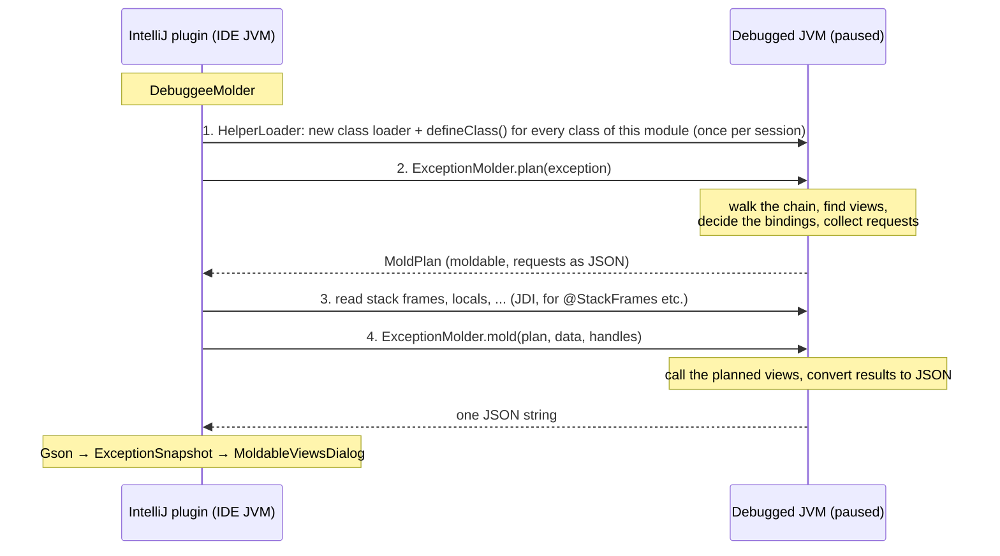

# moldable-snapshot-rt

The code that runs **inside the program being debugged**. When the debugger is paused at an exception, the IntelliJ
plugin injects this module into the paused JVM and calls two methods: `plan` finds the views of the exception chain
and says which debugger data they need, `mold` runs them with that data and returns one JSON string describing the
exception chain and every view of every exception in it. The plugin only draws what that JSON says.

If you remember one thing: **the plugin does the debugger work, this module does the reflection work.** The plugin
can read stack frames and local variables (JDI); only code running in the debuggee can call `@DebugView` methods, and
only the debuggee knows which views exist (from the view manifests on its classpath).

## Contents

- [The big picture](#the-big-picture)
- [Why it looks complicated](#why-it-looks-complicated)
- [One snapshot, step by step](#one-snapshot-step-by-step)
- [The protocol](#the-protocol)
- [Where views come from](#where-views-come-from)
- [Running a view](#running-a-view)
- [The output JSON](#the-output-json)
- [Class by class](#class-by-class)
- [Rules for changing this module](#rules-for-changing-this-module)

## The big picture



Step 3 comes after method calls in the debuggee (`defineClass`, `plan`). Such a call invalidates the thread's JDI
stack frame mirrors, but not the stack itself: the providers read the frames fresh after it. The uncaught-exception
stop only needs step 2: `moldable` decides whether the debugger stops.

## Why it looks complicated

Almost every odd-looking choice follows from one fact: these classes are **defined from their bytes into an
arbitrary JVM** that knows nothing about the plugin.

| Constraint | Consequence in the code |
| --- | --- |
| The debuggee may run Java 8 | `options.release = 8` in [build.gradle.kts](build.gradle.kts); no `var`, records, `List.of`, ... |
| The debuggee has no libraries of ours | Only the JDK. JSON is written by hand ([Json](src/main/java/ch/moldexj/runtime/mold/Json.java)); no Gson, and no JSON parser either, so data from the plugin comes in binary. |
| The app may not depend on `moldable-views` at all, or may have its own copy | Views are found by annotation **simple name** (`DebugView`, `Exception`), and results are read by **duck typing** (`kind()`, `text()`, `rows()`, ...), never by `instanceof` on our types. |
| Parameter annotations (`@Exception`, `@StackFrames`) are `CLASS`-retained | Reflection cannot see them. Views with parameters are only known from the view manifest, written by `moldable-views-processor`. |
| The plugin must pass data through JDI, where every call is slow | Two calls: `plan(exception)` returns one object with two fields, `mold(plan, byte[], Object[])` returns one string. Hence the binary value format. |
| Code in the debuggee is untrusted and may be broken | Every call into it is wrapped ([Safe](src/main/java/ch/moldexj/runtime/util/Safe.java), `try/catch Throwable` everywhere), and output is capped (the `*_LIMIT` constants in `ChainWalker`, `Safe`, `ResultConverter` and `BuiltInViews`). `plan` and `mold` never throw. |
| The plugin needs to know which classes to define, and in which order | The build writes `META-INF/moldexj/runtime-classes` listing every class; the plugin ([RuntimeClasses](../intellij-plugin/src/main/java/ch/moldexj/debuggee/RuntimeClasses.java)) defines supertypes first. |

## One snapshot, step by step

[`ExceptionMolder.plan(root)`](src/main/java/ch/moldexj/runtime/ExceptionMolder.java):

1. **Collect the declared views** — [ViewCatalog.declared](src/main/java/ch/moldexj/runtime/view/ViewCatalog.java) reads
   every manifest on the classpath ([ClasspathManifests](src/main/java/ch/moldexj/runtime/view/ClasspathManifests.java)) and
   resolves the entries to methods ([ViewMethod.resolve](src/main/java/ch/moldexj/runtime/view/ViewMethod.java)), once per
   helper. Classes that can't be loaded become a note.
2. **Walk the chain** — [ChainWalker](src/main/java/ch/moldexj/runtime/plan/ChainWalker.java) visits the root, its cause,
   and its suppressed exceptions, depth first, and makes one [PlannedNode](src/main/java/ch/moldexj/runtime/plan/PlannedNode.java)
   per exception.
3. **Plan the views** — per node, [ViewCatalog.viewsFor](src/main/java/ch/moldexj/runtime/view/ViewCatalog.java) picks the
   views that apply, and each parameter gets a [Binding](src/main/java/ch/moldexj/runtime/plan/Binding.java). A parameter
   that needs debugger data becomes a request in the [RequestTable](src/main/java/ch/moldexj/runtime/plan/RequestTable.java),
   but only on the root: debugger data belongs to where the debugger stopped.
4. **Return** a [MoldPlan](src/main/java/ch/moldexj/runtime/MoldPlan.java): `moldable`, `requests`, and the planned
   nodes for `mold`.

[`ExceptionMolder.mold(plan, data, handles)`](src/main/java/ch/moldexj/runtime/ExceptionMolder.java):

1. **Decode the values** — [InjectedValues](src/main/java/ch/moldexj/runtime/value/InjectedValues.java) turns `data` +
   `handles` into a `List<Object>` (strings, boxed primitives, lists, maps, live objects, `Unavailable`), one per
   request.
2. **Run the planned views** — [ViewRunner](src/main/java/ch/moldexj/runtime/mold/ViewRunner.java) fills the parameters,
   calls the views and turns each result into a JSON view
   ([ResultConverter](src/main/java/ch/moldexj/runtime/mold/ResultConverter.java));
   [BuiltInViews](src/main/java/ch/moldexj/runtime/mold/BuiltInViews.java) adds Details, Stack trace and Fields.
3. **Return** `{"chain": [...], "notes": [...]}`. Anything that went wrong along the way is a note or an error view.

`mold` finds nothing itself: it runs exactly the views `plan` chose, so the data the plugin resolved always matches.

## The protocol

### `MoldPlan.requests` — the debugger data the views need

The plugin reads the two public fields of the plan with JDI (no method call). `requests` is JSON, one entry per
distinct parameter declaration, with all annotations of the parameter as the manifest has them. Example for
`ConstraintViolationExceptionViews.throwSite(@Exception ConstraintViolationException ex, @StackFrames(depth = 3) DebugStack stack)`:

```json
[{"annotations":[{"name":"ch.moldexj.view.annotation.StackFrames","attributes":{"depth":"i:3","fields":"z:false"}}]}]
```

The position in the array is the request index `k`. Attribute values keep the tagged form of the manifest
(`ViewManifest.encodeValue`), because JSON numbers lose their type. Two views asking for the same data share one
request. Which annotation of a parameter a provider understands is decided in the plugin (`DebuggerDataProviders`),
so unrelated annotations such as `@NotNull` are sent along and skipped there.

| Binding | Meaning |
| --- | --- |
| `EXCEPTION` | Pass the exception the view is shown for (`@Exception`). |
| `VALUE k` | Pass the value of request `k`. |
| `MISSING reason` | Can't be filled; show the reason instead of running the view. |

### `data` + `handles` — the debugger data

The plugin's data providers (e.g. `StackFramesProvider`) produce trees of maps, lists, primitives and JDI
`ObjectReference`s. [DebuggeeMarshaller](../intellij-plugin/src/main/java/ch/moldexj/debuggee/DebuggeeMarshaller.java)
writes them into one `byte[]` with `DataOutputStream`, one value per request; every live object is replaced by an
index into a separate `Object[]` (`handles`), which JDI can pass as real references. `InjectedValues` reads it back:

```
int count, then per value a tag byte:
Z B C S I J F D   primitives (JVM descriptor letters)
n                 null
s                 string: int length + UTF-8 bytes
l                 list:   int count + values
m                 map:    int count + (string key, value) pairs
h                 live object: int index into handles
u                 unavailable: string reason (the view shows it instead of running)
```

The two sides must stay in sync: a new tag goes into **both** `DebuggeeMarshaller` and `InjectedValues`.

Why two formats: each direction uses what the receiving side can read cheaply. The plugin has Gson, so everything the
debuggee returns is JSON (easy to write by hand). The debuggee has no parser, so everything the plugin sends is binary
(`DataInputStream` is in the JDK). A live object can't travel as text anyway.

### Maps become interfaces: `DataProxy`

A view asks for `DebugStack`, not a `Map`. [ValueAdapter](src/main/java/ch/moldexj/runtime/value/ValueAdapter.java) bridges
that: when a parameter's type is an interface and the value is a map, it creates a `java.lang.reflect.Proxy` whose
handler is [DataProxy](src/main/java/ch/moldexj/runtime/value/DataProxy.java). Calling `stack.frames()` returns
`map.get("frames")`, adapted to `List<DebugFrame>` — which turns each element map into another proxy, and so on.

Providers can add computed methods with two special map keys:

| Key | Effect |
| --- | --- |
| `"$lookup:frameOf": ["frames", "className", "methodName"]` | `frameOf(a, b)` returns the first element of `frames` whose `className` equals `a` and `methodName` equals `b`. |
| `"$text:text": "value"` | `text()` returns a safe, truncated `toString()` of the `value` entry. |

Unknown methods return `null` / `0` / `false`. This is why `moldable-views` can declare `DebugStack`, `DebugFrame`
and `DebugLocal` as plain interfaces with no implementation anywhere.

## Where views come from

Two sources:

| Source | Found by | Can fill |
| --- | --- | --- |
| **Manifests on the debuggee's classpath** (`META-INF/moldexj/views`, written by `moldable-views-processor`) | `ClasspathManifests`, cached in `ViewCatalog` | everything: `@Exception` here, every other annotation as a request to the plugin |
| **`@DebugView` instance methods on the exception class** | `ViewCatalog.viewsFor`, by reflection | parameterless methods only; a method with parameters and no manifest entry shows "This view has parameters, but no view manifest declares them…" |

The manifests are read once per helper, i.e. once per debug session and class loader; jars added to the classpath
later are not seen.

Which views apply to a given exception ([ViewMethod.appliesTo](src/main/java/ch/moldexj/runtime/view/ViewMethod.java)):

- **Instance views** apply when the exception is an instance of the declaring class, and are called on the exception.
- **Static views** apply when the exception fits the type of their `@Exception` parameter. A static view with no
  `@Exception` parameter is never shown.
- Overrides: the reflection scan walks from the most-derived class up and skips a method if a view with the same name
  and parameter count was already added, so subclass overrides win and nothing appears twice.
- Methods are matched by name, static-ness and parameter count; overloads with the same count are not told apart.

Class loading ([Reflection.classLoaders](src/main/java/ch/moldexj/runtime/util/Reflection.java)): the helper's loader is a
child of the stopped frame's loader. If the debugger stopped inside the JDK (e.g. `java.time` throwing), that is the
bootstrap loader, which can't see application classes, so the thread's context class loader is tried too.

## Running a view

[ViewRunner](src/main/java/ch/moldexj/runtime/mold/ViewRunner.java) for one planned view and one exception:

1. Build the arguments from the bindings. Any of these turns the view into an **`unavailable`** tab with a reason,
   without calling it:
   - a `MISSING` binding, e.g. debugger data on an exception that isn't the root (debugger data belongs to where the
     debugger stopped, not to causes or suppressed exceptions);
   - a value that is `Unavailable` (e.g. "This view needs the stack at the throw…");
   - a value that doesn't fit the parameter type.
2. Call the method. If it throws, the view becomes an **`error`** tab with the stack trace.
3. Convert the result ([ResultConverter](src/main/java/ch/moldexj/runtime/mold/ResultConverter.java)), by duck typing:

| Result | Becomes |
| --- | --- |
| `null` | text "(the view returned null)" |
| any `CharSequence` | `text` |
| object whose `kind()` (or `getKind()`) is `text` | `text` from `text()` |
| … `diff` | `diff` from `expected()`, `actual()`, `expectedLabel()`, `actualLabel()` |
| … `table` | `table` from `columns()`, `rows()`, optional `rowStyles()` |
| … `highlight` | `highlight` from `text()`, `spans()` (each `start()`, `end()`, `style()`, `tooltip()`), `caption()` |
| anything else | `text` from `toString()` |

Views are sorted by `priority` (default 100, from the `@DebugView` annotation), then title. Built-in views use
priorities 1000–1002, so they always come last.

## The output JSON

Parsed by Gson into [ExceptionSnapshot](../intellij-plugin/src/main/java/ch/moldexj/ExceptionSnapshot.java), which is
the authoritative list of fields.

```json
{
  "chain": [
    {
      "label": "Exception",
      "depth": 0,
      "type": "java.lang.IllegalStateException",
      "message": "checkout failed",
      "moldable": true,
      "views": [
        {"title": "Throw site", "kind": "table", "custom": true, "priority": 20,
         "columns": ["Frame", "Variable"], "rows": [["save:42", "user"]], "rowStyles": ["warning"]},
        {"title": "Details", "kind": "text", "custom": false, "priority": 1000, "text": "Type: ..."}
      ]
    },
    {"label": "Cause", "depth": 1, "type": "...", "message": "...", "moldable": false, "views": [...]}
  ],
  "notes": ["Views in com.acme.Views are not on the classpath of the debugged program; skipped."]
}
```

- `label` is `Exception`, `Cause` or `Suppressed[i]`; `depth` is the nesting level.
- `moldable` is true when the exception has at least one non-built-in view (even an error or unavailable one).
  `MoldPlan.moldable` is the same, for the whole chain: the automatic stop at uncaught exceptions only stops if it is
  true.
- `custom` is false only for the built-in views.
- `kind` is one of `text`, `diff`, `table`, `highlight`, `error`, `unavailable`.

Limits (`*_LIMIT` constants in the classes that apply them): 32 exceptions, depth 12, 100,000 characters per
text, 1,000 table rows / highlight spans, 200 stack frames. Cycles in the cause chain are detected by identity and
reported as a note.

## Class by class

All under `ch.moldexj.runtime`. Classes used from another package are `public final`; the others are package-private
(marked *internal*). Data holders expose `public final` fields instead of getters.

| Package | Class | Role |
| --- | --- | --- |
| *(root)* | `ExceptionMolder` | Public entry points `plan` and `mold`, called by the plugin. Wires everything together, catches everything. |
| | `MoldPlan` | The result of `plan`: `moldable` and `requests` (read by the plugin), the planned nodes for `mold`. |
| `catalog` | `ViewCatalog` | The views of the manifests (cached), and the views that apply to one exception. |
| | `ViewMethod` | A declaration resolved to a real `Method`, with title and priority read from the annotation. |
| | `ParameterDeclaration` | What the manifest says about one parameter: `EXCEPTION`, `DEBUGGER` (annotations), or `MISSING` (reason). |
| | `ViewDeclaration` *(internal)* | A view by class/method name plus its `ParameterDeclaration`s, as the manifest has it. |
| | `ClasspathManifests` *(internal)* | Reads every `META-INF/moldexj/views` on the debuggee's classpath. |
| `plan` | `ChainWalker` | Depth-first walk over cause and suppressed; cycle and size guards; one node per exception. |
| | `PlannedNode` | One exception of the chain with its planned views. |
| | `PlannedView` | A view with the `Binding`s for one exception. |
| | `Binding` | How one parameter is filled for one exception: `EXCEPTION`, `VALUE` (request index), or `MISSING` (reason). |
| | `RequestTable` | The distinct debugger-data requests of a plan, and their JSON. |
| `mold` | `ViewRunner` | Fills parameters, calls the planned views, catches failures, writes the JSON node. |
| | `Json` | Minimal JSON string escaping and array joining. |
| | `ResultConverter` *(internal)* | Duck-typed conversion of a view's return value to a JSON view. |
| | `BuiltInViews` *(internal)* | Details, Stack trace, Fields tabs for every exception. |
| | `ViewJson` *(internal)* | Small builder for one view's JSON object. |
| `value` | `InjectedValues` | Decoder for the binary value format. |
| | `Unavailable` | Marker for a value the debugger couldn't provide. |
| | `ValueAdapter` | Fits a value to a parameter or return type: numbers converted, lists adapted per element, maps proxied as interfaces. |
| | `DataProxy` *(internal)* | `InvocationHandler` that answers interface methods from a map (`$lookup:`, `$text:`). |
| `util` | `Reflection` | Class loading across loaders, finding `@DebugView` by name, calling accessors safely. |
| | `Safe` | `getMessage()`, `toString()`, stack traces and truncation that can't throw. |
| `manifest` | `ViewManifest` | Reader **and writer** of the manifest format and its tagged attribute values. Public: the annotation processor and the plugin use it too, which is why it lives here. |

## Rules for changing this module

- **Java 8, JDK only.** The compiler enforces the language level (`release = 8`); nothing enforces "no dependencies",
  so don't add any. Lambdas and streams are fine.
- **Never let anything escape.** Code you call in the debuggee can throw anything, including `Error`s. Catch
  `Throwable`, and turn problems into a note or an `error`/`unavailable` view.
- **Don't use our own types for things coming from the app.** Match by simple name and duck typing, as the existing
  code does, so apps can use their own `@DebugView` or none of our libraries.
- **New classes need nothing special.** The build lists every class in `META-INF/moldexj/runtime-classes`, and the
  plugin defines them all (supertypes first). Remember the helper is defined once per debug session, so restart the
  debug session to pick up changes.
- **Formats are shared; change both sides together:**

  | Format | Writer | Reader |
  | --- | --- | --- |
  | Requests (`MoldPlan.requests`) | `RequestTable` | `DebuggeeMolder` (plugin) |
  | Injected values | `DebuggeeMarshaller` (plugin) | `InjectedValues` |
  | Output JSON | `ViewJson` / `ResultConverter` / `ViewRunner` | `ExceptionSnapshot` + `MoldableViewsDialog` (plugin) |
  | Manifest | `ViewManifest.write` (processor) | `ViewManifest.read` (here) |
  | Proxy keys (`$lookup:`, `$text:`) | data providers (plugin) | `DataProxy` |
  | `plan` / `mold` signatures, `MoldPlan` field names | `ExceptionMolder`, `MoldPlan` | `DebuggeeMolder` (plugin) |

- **Adding a result kind:** handle it in `ResultConverter`, add its fields to `ExceptionSnapshot.View`, render it in
  the dialog, and (for app authors) add a factory in `DebugViews` in `moldable-views`.
